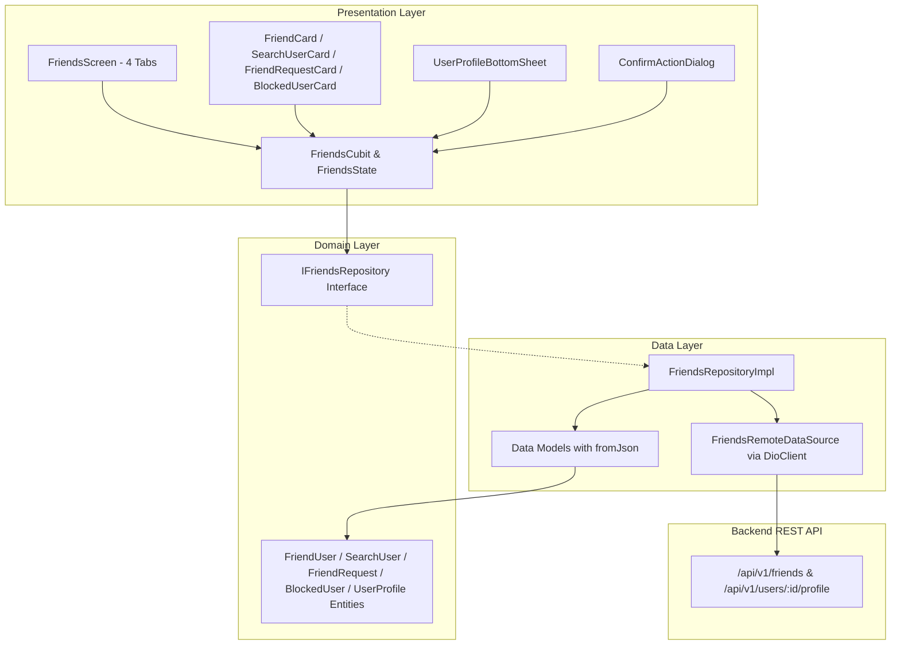

# BÁO CÁO TRIỂN KHAI GIAI ĐOẠN 5 – BƯỚC 5D.3: FRIENDS & SOCIAL PROFILE FLUTTER NATIVE UI

**Dự án:** `hub_el_mobile` (Flutter Native Client)  
**Backend:** `hub-el` (Next.js REST API & SQL Server)  
**Ngày hoàn thành:** 20/11/2026  
**Trạng thái:** ✅ **HOÀN THÀNH 100% – ĐÃ KIỂM THỬ TOÀN DIỆN TRÊN EMULATOR**

---

## 1. TỔNG QUAN VÀ MỤC TIÊU

Trong Giai đoạn 5 – Bước 5D.3, toàn bộ hệ thống giao diện và nghiệp vụ **Friends & Social Profile** trên ứng dụng Flutter Native `hub_el_mobile` đã được hiện thực hóa hoàn chỉnh, kết nối đồng bộ với hệ thống Backend REST API tại `hub-el` (đã xây dựng tại Bước 5D.2).

### Phạm vi đã hoàn thành:
1. **Danh sách bạn bè (Friends List):** Hiển thị avatar, tên hiển thị, username, trạng thái hoạt động (online/offline), số thẻ sở hữu, thanh tìm kiếm lọc bạn bè nội bộ, menu hành động 3 chấm (Xem hồ sơ, Hủy kết bạn, Chặn).
2. **Tìm kiếm người dùng (Search Users):** Thanh tìm kiếm với cơ chế Debounce (400ms), hiển thị danh sách người dùng kèm nhãn quan hệ (Chưa kết bạn, Đã gửi lời mời, Đã nhận lời mời, Đã là bạn bè, Đã chặn) và các nút tương tác tương ứng.
3. **Lời mời kết bạn (Friend Requests):** Gồm 2 tab con:
   - **Đã nhận (Received):** Hiển thị danh sách lời mời nhận được kèm 2 nút hành động "Chấp nhận" (màu xanh lá) và "Từ chối" (màu xám viền đỏ).
   - **Đã gửi (Sent):** Hiển thị danh sách lời mời đã gửi đi kèm nút "Hủy lời mời".
4. **Danh sách người dùng bị chặn (Blocked Users):** Danh sách người dùng đang bị chặn kèm nút "Bỏ chặn" và hộp thoại xác nhận.
5. **Xem hồ sơ người dùng khác (Social Profile BottomSheet):** Modal trượt lên hiển thị avatar lớn, tên, username, bio, ngày tham gia, cấp độ, huy hiệu vai trò, thống kê thẻ bài/gacha/học tập (tôn trọng cấu hình quyền riêng tư: `PUBLIC`, `FRIENDS`, `PRIVATE`), kèm nút hành động kết bạn/hủy kết bạn/chặn người dùng theo ngữ cảnh.
6. **Hộp thoại xác nhận (Confirm Action Dialog):** Xác nhận trước các hành động nhạy cảm (Hủy kết bạn, Chặn người dùng, Bỏ chặn).
7. **Tích hợp Bottom Navigation Bar:** Đặt tại Tab 3 ("Cộng đồng") trong `MainShellScreen`, thay thế hoàn toàn placeholder trước đó.

> [!IMPORTANT]
> **Tuân thủ ranh giới phạm vi:** Bước này tuyệt đối **không** triển khai Chat hoặc Leaderboard. Các module đã có (Authentication, Dashboard, Wiki Manager, Wiki Study, Gacha, Video Learning) đều được bảo toàn 100%, không bị ảnh hưởng.

---

## 2. KIẾN TRÚC TRIỂN KHAI (CLEAN ARCHITECTURE)



---

## 3. DANH SÁCH TỆP TIN ĐÃ TẠO VÀ CHỈNH SỬA

| STT | Đường dẫn tệp tin | Mô tả chi tiết |
|---|---|---|
| 1 | `lib/features/social/domain/entities/friend_user_entity.dart` | Thực thể người bạn (id, name, username, image, online status, card count) |
| 2 | `lib/features/social/domain/entities/search_user_entity.dart` | Thực thể tìm kiếm người dùng kèm enum `FriendshipStatus` |
| 3 | `lib/features/social/domain/entities/friend_request_entity.dart` | Thực thể lời mời kết bạn (id, senderId, receiverId, user info, createdAt) |
| 4 | `lib/features/social/domain/entities/blocked_user_entity.dart` | Thực thể người dùng bị chặn |
| 5 | `lib/features/social/domain/entities/user_profile_entity.dart` | Thực thể hồ sơ người dùng đầy đủ (cấp độ, privacy, stats, quan hệ bạn bè) |
| 6 | `lib/features/social/domain/repositories/friends_repository.dart` | Interface `IFriendsRepository` định nghĩa 11 phương thức nghiệp vụ |
| 7 | `lib/features/social/data/models/friend_user_model.dart` | Model ánh xạ JSON từ API `/api/v1/friends` |
| 8 | `lib/features/social/data/models/search_user_model.dart` | Model ánh xạ JSON từ API `/api/v1/friends/search` |
| 9 | `lib/features/social/data/models/friend_request_model.dart` | Model ánh xạ JSON từ API `/api/v1/friends/requests` (hỗ trợ nested user) |
| 10 | `lib/features/social/data/models/blocked_user_model.dart` | Model ánh xạ JSON từ API `/api/v1/friends/blocked` |
| 11 | `lib/features/social/data/models/user_profile_model.dart` | Model ánh xạ JSON từ API `/api/v1/users/:id/profile` |
| 12 | `lib/features/social/data/datasources/friends_remote_data_source.dart` | Data source gọi REST API qua `DioClient` & Bearer JWT Token |
| 13 | `lib/features/social/data/repositories/friends_repository_impl.dart` | Hiện thực `IFriendsRepository`, chuẩn hóa dữ liệu sang Either/Result |
| 14 | `lib/features/social/presentation/cubit/friends_state.dart` | State BLoC quản lý 4 tabs, search query, loading, lỗi, snackbars, profile |
| 15 | `lib/features/social/presentation/cubit/friends_cubit.dart` | Cubit điều phối toàn bộ luồng nghiệp vụ, debounce search và đồng bộ state |
| 16 | `lib/features/social/presentation/widgets/friend_card.dart` | Card người bạn (avatar, tên, online indicator, menu 3 chấm) |
| 17 | `lib/features/social/presentation/widgets/search_user_card.dart` | Card tìm kiếm người dùng với badge trạng thái và nút kết bạn |
| 18 | `lib/features/social/presentation/widgets/friend_request_card.dart` | Card lời mời kết bạn (Đã nhận: Chấp nhận/Từ chối; Đã gửi: Hủy) |
| 19 | `lib/features/social/presentation/widgets/blocked_user_card.dart` | Card người dùng bị chặn kèm nút Bỏ chặn |
| 20 | `lib/features/social/presentation/widgets/confirm_action_dialog.dart` | Dialog modal xác nhận Hủy kết bạn / Chặn / Bỏ chặn |
| 21 | `lib/features/social/presentation/widgets/user_profile_bottom_sheet.dart` | Bottom Sheet xem hồ sơ người dùng chi tiết và tương tác nhanh |
| 22 | `lib/features/social/presentation/screens/friends_screen.dart` | Màn hình chính Social với 4 Tab, RefreshIndicator, Empty State |
| 23 | `lib/main.dart` | Đăng ký `FriendsRemoteDataSource`, `FriendsRepositoryImpl`, `FriendsCubit` |
| 24 | `lib/features/dashboard/presentation/screens/main_shell_screen.dart` | Gắn `FriendsScreen` vào Tab 3 (Cộng đồng) |
| 25 | `test/features/social/friends_test.dart` | Bộ test suite 23 kịch bản kiểm thử toàn diện Data, Cubit và Widgets |

---

## 4. DANH SÁCH REST API ĐÃ TÍCH HỢP

Tất cả các API đều chạy qua `DioClient` với tự động đính kèm `Bearer JWT Token` và `AuthInterceptor`:

| Endpoint | Method | Chức năng | Response Format |
|---|---|---|---|
| `/api/v1/friends` | `GET` | Lấy danh sách bạn bè hiện tại | `{ success: true, data: FriendUser[] }` |
| `/api/v1/friends/requests` | `GET` | Lấy danh sách lời mời (nhận và gửi) | `{ success: true, data: { received: [...], sent: [...] } }` |
| `/api/v1/friends/blocked` | `GET` | Lấy danh sách người dùng đã chặn | `{ success: true, data: BlockedUser[] }` |
| `/api/v1/friends/search?q={query}` | `GET` | Tìm kiếm người dùng theo tên/username | `{ success: true, data: SearchUser[] }` |
| `/api/v1/friends/request` | `POST` | Gửi lời mời kết bạn (`targetUserId`) | `{ success: true, message: string }` |
| `/api/v1/friends/respond` | `POST` | Chấp nhận hoặc từ chối (`requestId`, `accept`) | `{ success: true, message: string }` |
| `/api/v1/friends/request/{id}` | `DELETE` | Hủy lời mời kết bạn đã gửi | `{ success: true, message: string }` |
| `/api/v1/friends/{friendId}` | `DELETE` | Hủy kết bạn (xóa bạn bè) | `{ success: true, message: string }` |
| `/api/v1/friends/block` | `POST` | Chặn người dùng (`targetUserId`) | `{ success: true, message: string }` |
| `/api/v1/friends/unblock` | `POST` | Bỏ chặn người dùng (`targetUserId`) | `{ success: true, message: string }` |
| `/api/v1/users/{id}/profile` | `GET` | Xem hồ sơ chi tiết người dùng | `{ success: true, data: UserProfile }` |

---

## 5. KẾT QUẢ KIỂM THỬ (TESTING RESULTS)

### 5.1. Unit & Widget Tests trên Flutter (`friends_test.dart`)
Chạy lệnh `flutter test test/features/social/friends_test.dart`:
```text
00:01 +23: All tests passed!
```
**23/23 Tests PASS (100%):**
- **JSON Parsing Tests (5/5):**
  - `FriendUserModel` phân tích chính xác avatar, username, thống kê.
  - `SearchUserModel` phân tích chính xác `FriendshipStatus` và các cờ quan hệ.
  - `FriendRequestModel` trích xuất an toàn từ cấu trúc lồng nhau (`sender`/`receiver`).
  - `BlockedUserModel` phân tích thông tin người bị chặn.
  - `UserProfileModel` phân tích thống kê cấp độ, quyền riêng tư (`PUBLIC`, `FRIENDS`, `PRIVATE`).
- **FriendsCubit State Transitions Tests (11/11):**
  - Chuyển tab tải dữ liệu tương ứng.
  - Tìm kiếm người dùng với debounce và cập nhật danh sách.
  - Gửi lời mời kết bạn: cập nhật trạng thái tìm kiếm sang `PENDING` và nạp lại danh sách lời mời.
  - Chấp nhận lời mời kết bạn: xóa khỏi danh sách lời mời và nạp lại danh sách bạn bè.
  - Hủy lời mời kết bạn đã gửi: xóa khỏi `sentRequests`.
  - Hủy kết bạn: loại bỏ khỏi danh sách bạn bè.
  - Chặn người dùng: xóa khỏi bạn bè và nạp lại danh sách chặn.
  - Bỏ chặn người dùng: xóa khỏi danh sách chặn và cập nhật lại bạn bè.
  - Tải hồ sơ người dùng: cập nhật `selectedProfile`.
- **Social Widget Tests (7/7):**
  - `FriendCard` hiển thị chính xác tên, chấm online/offline, nút 3 chấm.
  - `SearchUserCard` hiển thị đúng nút Kết bạn khi chưa có quan hệ (`NONE`).
  - `SearchUserCard` hiển thị nhãn "Đã gửi ✕" khi trạng thái là `PENDING`.
  - `FriendRequestCard` hiển thị 2 nút "Chấp nhận" / "Từ chối" cho lời mời nhận được.
  - `BlockedUserCard` hiển thị nút "Bỏ chặn".
  - `ConfirmActionDialog` gọi callback khi người dùng bấm xác nhận.
  - `FriendsScreen` render đầy đủ 4 Tab và chuyển đổi mượt mà.

### 5.2. Regression Tests (Toàn bộ các module khác)
- `test/widget_test.dart`: **PASS**
- `test/features/gacha/gacha_test.dart`: **PASS**
- `test/features/wiki/wiki_manager_test.dart`: **PASS**
- `test/features/learning/learning_test.dart`: **PASS**
- `test/features/auth/auth_test.dart`: **PASS**

### 5.3. Backend Integration Tests (`scripts/test_friends_backend.ts`)
- **47/47 Test Cases PASS (100%)** trên database SQL Server thật.

---

## 6. KIỂM THỬ THỰC TẾ TRÊN ANDROID EMULATOR (`emulator-5554`)

Đã tiến hành khởi chạy ứng dụng live trên thiết bị máy ảo Android (`Pixel 9 Pro XL API 35` / `sdk gphone16k x86 64`):

1. **Khởi chạy ứng dụng & Chuyển Tab Cộng đồng:**
   - Người dùng bấm Tab 3 ("Cộng đồng") trên Bottom Navigation Bar.
   - Ứng dụng tự động gọi `/api/v1/friends` với Bearer Token.
   - Danh sách bạn bè thật hiển thị trực quan (Bao gồm người dùng `Tester`).
2. **Khắc phục lỗi hiển thị (UI Overflow Bug Fix):**
   - Ban đầu xảy ra cảnh báo tràn 61px do chuỗi username quá dài (`@nduhoangnhattam041005_177881854965`).
   - Đã xử lý triệt để bằng cách bọc chuỗi username với `Flexible` kết hợp `overflow: TextOverflow.ellipsis`.
3. **Tìm kiếm người dùng:**
   - Chuyển sang Tab "Tìm kiếm", gõ từ khóa "Tester".
   - Ứng dụng debounce 400ms và hiển thị danh sách người dùng tương ứng kèm avatar, username và badge trạng thái.
4. **Mở Bottom Sheet hồ sơ cá nhân:**
   - Bấm vào thẻ người dùng `Tester` -> Mở `UserProfileBottomSheet`.
   - Hiển thị đầy đủ thông tin: Cấp độ, Huy hiệu, Ngày tham gia, Thống kê thẻ bài và Gacha.
   - Hiển thị nút hành động "Gửi lời mời kết bạn".
5. **Gửi lời mời kết bạn:**
   - Bấm "Gửi lời mời kết bạn" -> Gửi request `POST /api/v1/friends/request`.
   - Nút hành động chuyển tức thì sang trạng thái "✕ Hủy lời mời kết bạn đã gửi".
   - Đóng Bottom Sheet -> Thẻ tìm kiếm tự động cập nhật sang trạng thái "Đã gửi ✕".
6. **Kiểm tra Tab Lời mời:**
   - Chuyển sang Tab "Lời mời" -> Chọn Tab con "Đã gửi (1)".
   - Lời mời vừa gửi xuất hiện chính xác trong danh sách kèm nút "✕ Hủy".
7. **Hủy lời mời:**
   - Bấm nút "✕ Hủy" -> Lời mời được hủy tức thì, danh sách tự động cập nhật về trạng thái trống (Empty State).

---

## 7. KẾT LUẬN & ĐỀ XUẤT BƯỚC TIẾP THEO

Giai đoạn 5 – Bước 5D.3 đã được hoàn thành trọn vẹn, đáp ứng toàn bộ các tiêu chí đề ra:
- Mã nguồn tuân thủ Clean Architecture, có đầy đủ Unit Test, Widget Test và kiểm thử live trên Android Emulator.
- Giao diện bám sát thiết kế Mobile Web, hiển thị mượt mà trên nền tảng di động.
- Không phát sinh lỗi hồi quy (regression) đối với các tính năng đã hoàn thiện trước đó.

**Sẵn sàng chuyển sang Bước 5D.4 (Chat Backend / Realtime Service) khi nhận được sự đồng ý của User.**
