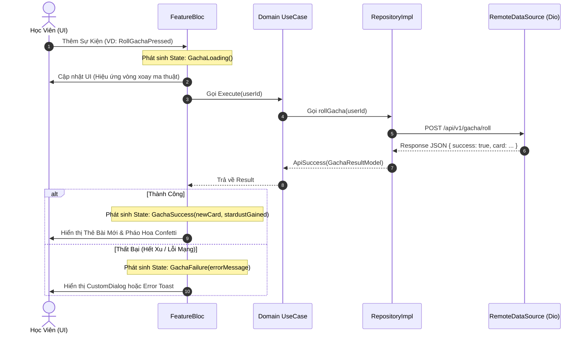

# FLUTTER MOBILE APP ARCHITECTURE - HUB-EL

> **Tài liệu đặc tả Kiến trúc Phần mềm Chi tiết cho dự án Flutter Mobile `hub_el_mobile`**  
> Tuân thủ mô hình **Feature-First Clean Architecture** kết hợp BLoC Pattern và Dio Network Layer.

---

## 1. Sơ Đồ Kiến Trúc Tổng Thể (Architectural Diagram)

```
┌────────────────────────────────────────────────────────────────────────┐
│                        PRESENTATION LAYER                              │
│   ┌──────────────────────────┐      ┌──────────────────────────────┐   │
│   │ UI Screens & Widgets     │ ◄─── │ State Management (BLoC/Cubit)│   │
│   │ (Stateless/Stateful)     │      │ (States, Events, Observers)  │   │
│   └──────────────────────────┘      └──────────────┬───────────────┘   │
└────────────────────────────────────────────────────┼───────────────────┘
                                                     │ Calls
┌────────────────────────────────────────────────────▼───────────────────┐
│                           DOMAIN LAYER                                 │
│                   (Pure Dart - No UI Dependencies)                     │
│   ┌──────────────────────────┐      ┌──────────────────────────────┐   │
│   │ Use Cases / Interactors  │ ───► │ Repository Interfaces        │   │
│   │ (GetQuests, RollGacha...)│      │ (AuthRepository, etc.)       │   │
│   └──────────────────────────┘      └──────────────▲───────────────┘   │
│   ┌──────────────────────────┐                     │                   │
│   │ Domain Entities          │                     │                   │
│   └──────────────────────────┘                     │                   │
└────────────────────────────────────────────────────┼───────────────────┘
                                                     │ Implements
┌────────────────────────────────────────────────────▼───────────────────┐
│                            DATA LAYER                                  │
│   ┌────────────────────────────────────────────────────────────────┐   │
│   │ Repository Implementations (AuthRepositoryImpl, etc.)          │   │
│   └────────────────────────┬───────────────────────────────────────┘   │
│                            │ Coordinates                               │
│            ┌───────────────┴───────────────┐                           │
│            ▼                               ▼                           │
│   ┌──────────────────┐            ┌──────────────────┐                 │
│   │ Remote DataSource│            │ Local DataSource │                 │
│   │ (Dio Client,     │            │ (SecureStorage,  │                 │
│   │  Socket Client)  │            │  SharedPreferences)                │
│   └────────┬─────────┘            └────────┬─────────┘                 │
└────────────┼───────────────────────────────┼───────────────────────────┘
             │ HTTP / WebSocket              │ Disk I/O
             ▼                               ▼
       Backend Server                 Local Storage
```

---

## 2. Cấu Trúc Thư Mục Feature-First (Directory Tree)

Cấu trúc thư mục được phân bổ tách biệt theo nghiệp vụ, mỗi feature là một module hoàn chỉnh:

```
hub_el_mobile/lib/
├── app/
│   ├── app.dart                     # Khởi tạo MaterialApp, Theme, Route
│   ├── observer.dart                # AppBlocObserver theo dõi biến động State
│   └── routes.dart                  # Cấu hình định tuyến điều hướng màn hình
├── core/
│   ├── constants/                   # API Endpoints, AppConstants
│   ├── errors/                      # Exceptions, Failures, Error Handler
│   ├── network/                     # DioClient, AuthInterceptor, ApiResult
│   ├── storage/                     # SecureStorageHelper, PreferenceHelper
│   ├── theme/                       # AppColors, AppTextStyles, AppTheme (Đã có ở Phase 2)
│   ├── utils/                       # Formatters, LevelingUtils, Sound/Haptic
│   └── widgets/                     # CustomButton, CustomTextField... (Đã có ở Phase 2)
└── features/
    ├── auth/                        # Xác thực, Đăng nhập, Đăng ký, OTP
    │   ├── data/
    │   │   ├── datasources/         # AuthRemoteDataSource, AuthLocalDataSource
    │   │   ├── models/              # UserModel (fromJson, toJson)
    │   │   └── repositories/        # AuthRepositoryImpl
    │   ├── domain/
    │   │   ├── entities/            # UserEntity
    │   │   ├── repositories/        # IAuthRepository (Interface)
    │   │   └── usecases/            # LoginUseCase, RegisterUseCase, GetCurrentUserUseCase
    │   └── presentation/
    │       ├── blocs/               # AuthBloc (LoginEvent, AuthState...)
    │       └── screens/             # LoginScreen, RegisterScreen, ForgotPasswordScreen
    ├── dashboard/                   # Trang chủ, Nhiệm vụ ngày, Header Stats
    ├── video_learning/              # Khám phá video giáo dục, Trình phát, AI Quiz
    ├── wiki_learning/               # Thẻ bài Wiki, Bài đọc AI thích ứng, Thức tỉnh sao
    ├── gacha/                       # Vòng quay Gacha thẻ bài, Bảo hiểm Pity, Shop Bụi Sao
    ├── vocabulary/                  # Sổ tay từ vựng cá nhân, Phát âm âm thanh
    ├── social/                      # Bạn bè, Lời mời, Chat thời gian thực 1-1 & Nhóm
    ├── leaderboard/                 # Bảng vinh danh 4 tiêu chí
    ├── achievements/                # Danh hiệu 6 Tier và Easter Eggs
    ├── store/                       # Nạp tiền MoMo, Đổi tài nguyên
    └── profile/                     # Trang cá nhân, Cài đặt bảo mật & thông báo
```

---

## 3. Thiết Kế Tầng Mạng (Network Layer with Dio)

### A. Cấu Hình Dio Client Singleton (`core/network/dio_client.dart`)
- **Timeout an toàn:** `connectTimeout: 15s`, `receiveTimeout: 15s`, `sendTimeout: 15s`.
- **Base Headers:**
  ```dart
  {
    'Accept': 'application/json',
    'Content-Type': 'application/json',
  }
  ```

### B. Hệ Thống Interceptors Đa Tầng
1. **`AuthInterceptor`**:
   - Tự động lấy Access Token từ `FlutterSecureStorage` và gắn vào Header:  
     `Authorization: Bearer <TOKEN>`.
   - Nếu Backend trả về mã `401 Unauthorized`:
     - Tự động gọi endpoint Refresh Token để cấp token mới mà không làm gián đoạn trải nghiệm người dùng.
     - Nếu Refresh Token hết hạn $\rightarrow$ Bắn sự kiện `SessionExpiredEvent` để đá văng về màn hình Đăng nhập kèm thông báo.
2. **`LoggingInterceptor`**:
   - In chi tiết URL, Method, Request Body và Response JSON trong môi trường Debug (tắt hoàn toàn ở môi trường Production Release).
3. **`ErrorInterceptor`**:
   - Bắt các lỗi socket mất mạng (`DioExceptionType.connectionError`), quá hạn chờ (`connectionTimeout`), hoặc mã lỗi HTTP $5xx/4xx$ để đóng gói thành `AppException`.

### C. Mẫu Trả Về Thống Nhất (`ApiResult<T>`)
Áp dụng mẫu Either/Result để loại bỏ việc văng exception không kiểm soát tại tầng UI:
```dart
sealed class ApiResult<T> {
  const ApiResult();
}

class ApiSuccess<T> extends ApiResult<T> {
  final T data;
  final String? message;
  const ApiSuccess(this.data, {this.message});
}

class ApiFailure<T> extends ApiResult<T> {
  final String message;
  final int? statusCode;
  final String? errorCode;
  const ApiFailure({required this.message, this.statusCode, this.errorCode});
}
```

---

## 4. Thiết Kế Quản Lý Trạng Thái (State Management with BLoC)

### A. Quy Chuẩn Đặt Tên State & Event
Mỗi Feature áp dụng mô hình trạng thái bất biến (Immutable State):



### B. Trạng Thái Dùng Chung (Cross-Feature States)
1. **`AuthBloc`**: Quản lý phiên toàn cục (`Authenticated`, `Unauthenticated`, `SessionExpired`).
2. **`UserStatsBloc`**: Quản lý các chỉ số trên Header Pill Bar (Cấp độ, XP, Streak, Năng lượng, Xu, Ngọc), có thể lắng nghe trực tiếp sự kiện hoàn thành bài học từ `QuizBloc` hoặc `GachaBloc` để cập nhật số dư tức thời.
3. **`SocketBloc`**: Duy trì kết nối WebSocket Socket.io, tự động reconnect và lắng nghe sự kiện `receive_message`, `receive_friend_request`.

---

## 5. Thiết Kế Quản Lý Lỗi Tập Trung (Error Handling)

Hệ sinh thái lỗi được chuẩn hóa tại `core/errors/`:

```dart
abstract class AppException implements Exception {
  final String message;
  final String? code;
  AppException(this.message, [this.code]);
}

class NetworkException extends AppException {
  NetworkException([super.message = 'Không có kết nối mạng. Vui lòng kiểm tra WiFi/4G.']);
}

class UnauthorizedException extends AppException {
  UnauthorizedException([super.message = 'Phiên đăng nhập đã hết hạn. Vui lòng đăng nhập lại.']);
}

class ServerException extends AppException {
  final int? statusCode;
  ServerException(super.message, [this.statusCode]);
}

class InsufficientResourceException extends AppException {
  final String resourceType; // 'COINS' | 'ENERGY' | 'GEMS'
  InsufficientResourceException(this.resourceType, super.message);
}
```

---

## 6. Thiết Kế Lưu Trữ Dữ Liệu Cục Bộ (Local Storage Strategy)

1. **`FlutterSecureStorage` (Mã hóa phần cứng):**
   - Lưu trữ `access_token`, `refresh_token`, `user_id`.
   - Sử dụng Android KeyStore và iOS Keychain chống trích xuất dữ liệu khi thiết bị bị root/jailbreak.
2. **`SharedPreferences` (Lưu trữ cấu hình nhẹ):**
   - Lưu trữ `theme_mode` (Light / Dark).
   - Lưu trữ `target_language` và `language_level` (mặc định En, A2).
   - Lưu trữ cờ hướng dẫn sử dụng lần đầu (`is_first_launch`).
3. **Bộ nhớ đệm (Cache) Ngoại tuyến:**
   - Dữ liệu Sổ tay từ vựng và Thẻ bài Wiki đã mở được lưu cache tạm thời để người học vẫn có thể xem lại từ mới khi đi máy bay hoặc mất mạng.

