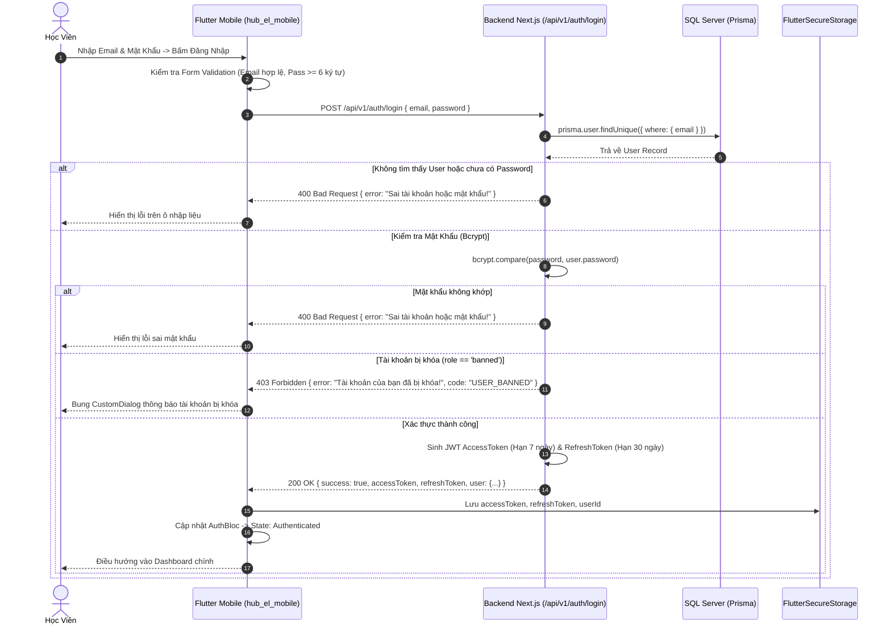
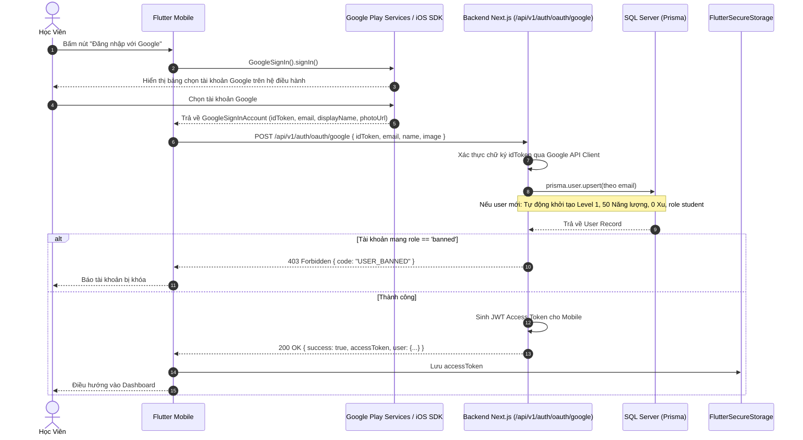
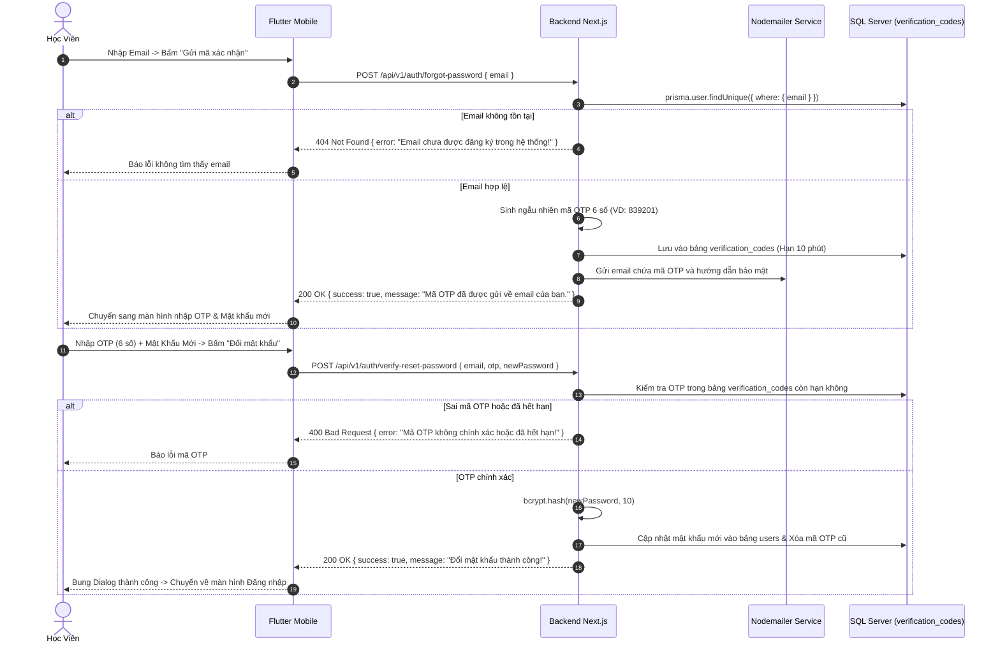

# AUTHENTICATION & SESSION MANAGEMENT SPECIFICATION - HUB-EL

> **Tài liệu thiết kế chi tiết Luồng Xác Thực, Quản lý Token và Phiên Đăng Nhập cho Flutter Mobile**  
> Đối chiếu từ hệ thống NextAuth v5 tại [`hub-el/src/lib/auth.ts`](file:///d:/Coder/Web/hub-el/src/lib/auth.ts)

---

## 1. Phân Tích Hệ Thống Xác Thực Web Hiện Tại (NextAuth v5)

Căn cứ từ mã nguồn [`hub-el/src/lib/auth.ts`](file:///d:/Coder/Web/hub-el/src/lib/auth.ts):
- **Cấu hình phiên:** `session: { strategy: "jwt" }`.
- **Cơ chế lưu trữ Web:** Sử dụng HttpOnly Cookies (`authjs.session-token`). Trình duyệt Web tự động đính kèm cookie này trong mọi request.
- **Phương thức xác thực:**
  1. `CredentialsProvider`: So khớp email và mật khẩu mã hóa bằng `bcrypt.compare`.
  2. `Google`: Tích hợp Google OAuth2.
  3. `GitHub`: Tích hợp GitHub OAuth.
- **Chốt chặn phân quyền & Chặn tài khoản Banned:**
  - Chốt chặn 1 (`signIn` callback): Nếu `dbUser.role === 'banned'` $\rightarrow$ Trả về `false` hoặc điều hướng sang `/?error=banned`.
  - Chốt chặn 2 (`authorize` method): Ném lỗi `CustomAuthError("Tài khoản của bạn đã bị khóa!")`.
  - Chốt chặn 3 (`jwt` & `session` callbacks): Đóng gói `status: "BANNED"` và đẩy ra session để frontend đá văng người dùng.

---

## 2. Thách Thức Khi Chuyển Sang Mobile & Giải Pháp Kiến Trúc

| Thách Thức Kỹ Thuật Trên Mobile | Rủi Ro Nếu Giữ Nguyên Cơ Chế Web | Giải Pháp Chuẩn Hóa Cho Flutter |
| :--- | :--- | :--- |
| **HttpOnly Cookie:** Mobile App không phải là trình duyệt web chuẩn, cookie dễ bị mất khi app bị kill hoặc chạy ngầm. | Mất phiên đăng nhập liên tục, trải nghiệm người dùng kém. | **Chuyển sang cơ chế Bearer Token (JWT Access Token & Refresh Token)** chuẩn RESTful cho Mobile. |
| **Google OAuth qua WebView:** Google chặn không cho đăng nhập OAuth qua In-App WebView nhúng vì lý do an ninh (Disallowed User-Agent). | Người dùng không thể đăng nhập Google trên app mobile. | Sử dụng **Native Google Sign-In SDK** (`google_sign_in`), lấy `idToken` từ Google Play Services / iOS Keychain và gửi về Backend xác thực. |
| **Kiểm tra tài khoản bị cấm (Banned):** Web dùng cơ chế cookie để redirect. | App mobile không tự văng ra nếu token cũ chưa hết hạn. | `AuthInterceptor` trên Flutter bắt mã lỗi `403 Forbidden` hoặc trường `role: "banned"` để tự động xóa token và hiển thị Dialog khóa nick. |

---

## 3. Sơ Đồ Chi Tiết Các Luồng Xác Thực (Authentication Flowcharts)

### A. Luồng Đăng Nhập Bằng Email & Mật Khẩu (Credentials Login Flow)



---

### B. Luồng Đăng Nhập Google Native Trên Mobile (Google Sign-In Flow)



---

### C. Luồng Quên Mật Khẩu & Xác Thực Mã OTP (Forgot Password & OTP Flow)

Căn cứ từ [`src/actions/auth/reset.ts`](file:///d:/Coder/Web/hub-el/src/actions/auth/reset.ts):



---

### D. Luồng Tự Động Làm Mới Token & Hết Hạn Phiên (Token Refresh Interceptor Flow)

```mermaid
flowchart TD
    Request[Flutter App gửi HTTP Request bất kỳ] --> HasToken{Có Access Token trong SecureStorage?}
    
    HasToken -- Có --> Attach[Gắn Header Authorization: Bearer AccessToken]
    HasToken -- Không --> Direct[Gửi Request không kèm Token]

    Attach --> Send[Gửi Request tới Backend]
    Direct --> Send

    Send --> ResponseCheck{Mã phản hồi HTTP là gì?}
    
    ResponseCheck -- 200 OK --> Success[Xử lý Data bình thường]
    ResponseCheck -- 403 Forbidden --> CheckBan{Lỗi USER_BANNED?}
    
    CheckBan -- Có --> BanAction[Xóa toàn bộ Token<br>Hiển thị Dialog Tài khoản bị khóa<br>Đá về màn hình Đăng nhập]
    CheckBan -- Không --> PermissionError[Báo lỗi không có quyền truy cập]

    ResponseCheck -- 401 Unauthorized --> TokenExpired[Access Token đã hết hạn!]
    
    TokenExpired --> TryRefresh{Có Refresh Token hợp lệ?}
    
    TryRefresh -- Có --> CallRefresh[Gửi POST /api/v1/auth/refresh-token<br>kèm RefreshToken]
    
    CallRefresh --> RefreshResult{Refresh thành công?}
    RefreshResult -- Thành công --> SaveNew[Lưu Access Token mới vào SecureStorage<br>Tự động gửi lại Request ban đầu (Retry)]
    RefreshResult -- Thất bại --> Logout[Xóa sạch Session trong SecureStorage<br>Bắn sự kiện SessionExpired<br>Chuyển về màn hình Login]
    
    TryRefresh -- Không --> Logout
```

---

## 4. Quản Lý Thông Tin Phiên Tại Local Storage (Flutter)

### Bảng Lưu Trữ Bảo Mật (`FlutterSecureStorage`):
| Key Định Danh | Kiểu Giá Trị | Mục Đích Sử Dụng |
| :--- | :--- | :--- |
| `hubel_access_token` | `String` | JWT Bearer Token đính kèm mọi request cần xác thực. |
| `hubel_refresh_token`| `String` | Token dự phòng dùng xin cấp lại Access Token mới. |
| `hubel_user_id` | `String` | CUID người dùng, dùng định danh phòng Socket.io (`join_room`). |
| `hubel_user_email` | `String` | Email đăng nhập gần nhất (dùng tự động điền sẵn). |

### Bảng Cấu Hình Người Dùng (`SharedPreferences`):
| Key Định Danh | Kiểu Giá Trị | Giá Trị Mặc Định | Ý Nghĩa |
| :--- | :--- | :--- | :--- |
| `app_theme_mode` | `String` | `'SYSTEM'` | `'LIGHT'`, `'DARK'`, hoặc `'SYSTEM'`. |
| `target_language` | `String` | `'en'` | Ngôn ngữ đang theo học. |
| `language_level` | `String` | `'A2'` | Trình độ mong muốn để AI sinh bài đọc. |
| `has_seen_onboarding`| `bool` | `false` | Đã xem màn hình hướng dẫn ban đầu chưa. |

