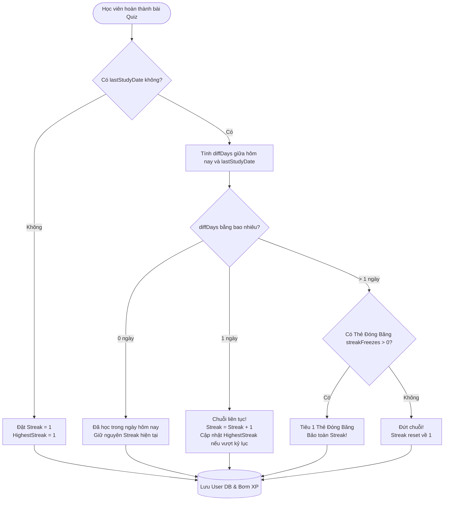

# BUSINESS LOGIC & ALGORITHMIC RULES - HUB-EL

> **Tài liệu đặc tả toàn bộ quy tắc nghiệp vụ, công thức toán học và logic backend của Hub-EL**  
> Dùng làm căn cứ bất biến để triển khai chính xác trên Flutter Mobile App.

---

## 1. Hệ thống Cấp độ, Kinh nghiệm (Leveling & XP)

Căn cứ từ [`src/lib/leveling.ts`](file:///d:/Coder/Web/hub-el/src/lib/leveling.ts), [`src/components/layout/sidebar.tsx`](file:///d:/Coder/Web/hub-el/src/components/layout/sidebar.tsx#L98-L115) và [`src/components/layout/header.tsx`](file:///d:/Coder/Web/hub-el/src/components/layout/header.tsx#L202-L216):

### A. Công thức Tính Lượng XP cần để Lên Cấp
Kinh nghiệm cần thiết để lên cấp độ kế tiếp ($Level \rightarrow Level + 1$):
$$\text{reqXp}(Level) = \left\lfloor 500 + Level^2 \times 20 \right\rfloor$$

- **Cấp 1:** $500 + 1^2 \times 20 = 520\text{ XP}$
- **Cấp 2:** $500 + 2^2 \times 20 = 580\text{ XP}$
- **Cấp 5:** $500 + 5^2 \times 20 = 1000\text{ XP}$
- **Cấp 10:** $500 + 10^2 \times 20 = 2500\text{ XP}$
- **Cấp 50:** $500 + 50^2 \times 20 = 50500\text{ XP}$

### B. Thuật toán Xử lý Cộng XP & Tràn Cấp (XP Overflow)
Khi học viên nhận được một lượng $\Delta\text{XP}$:
```typescript
let newXp = currentXp + deltaXp;
let newLevel = currentLevel;
let required = Math.floor(500 + Math.pow(newLevel, 2) * 20);

while (newXp >= required) {
  newXp -= required;
  newLevel += 1;
  required = Math.floor(500 + Math.pow(newLevel, 2) * 20);
}
// Cập nhật newLevel, newXp
```

### C. Công thức Tính Tổng XP Trọn Đời (Lifetime XP cho Bảng Xếp Hạng)
Dùng trong [`src/actions/leaderboard.ts`](file:///d:/Coder/Web/hub-el/src/actions/leaderboard.ts#L66-L72):
$$\text{LifetimeXP} = \text{currentXp} + \sum_{i=1}^{\text{Level}-1} \left\lfloor 500 + i^2 \times 20 \right\rfloor$$

---

## 2. Hệ thống Năng lượng AI (AI Tokens / Energy)

Căn cứ từ [`src/lib/leveling.ts`](file:///d:/Coder/Web/hub-el/src/lib/leveling.ts#L5-L10) và [`src/actions/quiz.ts`](file:///d:/Coder/Web/hub-el/src/actions/quiz.ts#L74-L105):

### A. Công thức Giới hạn Bình Năng lượng Tối đa (Max Energy Cap)
$$\text{BaseCap}(Level) = 50 + (Level - 1) \times 5$$
$$\text{MaxEnergy}(Level, \text{isPro}) = \begin{cases} \text{BaseCap}(Level) + 50 & \text{nếu tài khoản là PRO / VIP} \\ \text{BaseCap}(Level) & \text{nếu tài khoản Thường} \end{cases}$$

- **Học viên thường Cấp 1:** $50 + 0 = 50\text{⚡}$
- **Học viên PRO Cấp 1:** $50 + 50 = 100\text{⚡}$
- **Học viên thường Cấp 10:** $50 + 9 \times 5 = 95\text{⚡}$
- **Học viên PRO Cấp 10:** $95 + 50 = 145\text{⚡}$

### B. Cơ chế Hồi phục Tự động Mỗi Ngày (Daily Energy Refill)
- **Chu kỳ:** Mỗi ngày khi bước sang 00:00:00 (Tính theo múi giờ `Asia/Ho_Chi_Minh` = UTC+7), khi user thực hiện hoạt động đầu tiên hoặc mở app, nếu `today !== lastDailyCoinGrant`:
  - Bình năng lượng được **bơm đầy 100%** lên mức `MaxEnergy`.
  - Cập nhật mốc `lastDailyCoinGrant = new Date()`.

### C. Chi phí Tiêu thụ Năng lượng (Energy Consumption)
1. **Tạo bài học & Quiz từ Thẻ Wiki ([`src/actions/quiz.ts`](file:///d:/Coder/Web/hub-el/src/actions/quiz.ts#L99-L104)):**
   - Tài khoản Thường: **$10\text{⚡}$ cố định** cho mỗi lần sinh bài giảng AI.
   - Tài khoản PRO: **$7\text{⚡}$ cố định** (Giảm 30% năng lượng).
2. **Tạo Quiz từ Video YouTube ([`src/actions/quiz/ai.ts`](file:///d:/Coder/Web/hub-el/src/actions/quiz/ai.ts#L22-L30)):**
   - Mặc định: $1\text{ câu hỏi} = 1\text{⚡}$.
   - Tài khoản Thường tạo 5 câu: Tốn **$5\text{⚡}$**.
   - Tài khoản PRO: Giảm 30% $\rightarrow \text{ceil}(Count \times 0.7)$ (Ví dụ: 5 câu chỉ tốn $\text{ceil}(3.5) = 4\text{⚡}$). Tối thiểu luôn là $1\text{⚡}$.

---

## 3. Hệ thống Tiền tệ & Kinh tế (3-Tier Currencies)

| Loại Tiền | Tên Hiển thị | Nguồn Thu Nhập (Earn) | Mục Đích Sử Dụng (Spend) |
| :--- | :--- | :--- | :--- |
| **`freeCoins`** | Xu Gacha (Vàng) | Làm xong bài Quiz (+10 Xu), Hoàn thành nhiệm vụ ngày, Nhận thưởng thành tựu | - Quay thẻ Gacha (100 Xu/lượt)<br>- Bảo vệ sao thẻ bài khi rớt Quiz (50 Xu/lần)<br>- Đổi lấy Năng lượng (200 Xu = 10⚡) |
| **`aiTokens`** | Năng lượng AI (Xanh dương) | Tự động hồi đầy mỗi ngày, Thưởng thành tựu, Đổi từ Ngọc/Xu | - Trừ khi tạo bài đọc Wiki AI (7-10⚡)<br>- Trừ khi tạo câu hỏi Quiz từ Video |
| **`premiumCoins`** | Ngọc / Xu Nạp (Tím) | Nạp tiền mặt qua MoMo Gateway | - Đổi sang Xu Gacha (100 Ngọc = 1000 Xu)<br>- Đổi sang Năng lượng (50 Ngọc = 50⚡) |
| **`stardust`** | Bụi Sao (Lấp lánh) | Nhận được khi quay trúng thẻ bài đã sở hữu trong tủ đồ | - Dùng trong Shop Bụi Sao để đổi lấy các thẻ bài còn thiếu chưa sở hữu |

### Bảng Quy tắc Đổi Tài nguyên Trong Cửa hàng ([`src/actions/store.ts`](file:///d:/Coder/Web/hub-el/src/actions/store.ts#L7-L11)):
- `GEM_TO_ENERGY`: 50 Ngọc $\rightarrow$ 50 Năng lượng
- `GEM_TO_COIN`: 100 Ngọc $\rightarrow$ 1,000 Xu Gacha
- `COIN_TO_ENERGY`: 200 Xu Gacha $\rightarrow$ 10 Năng lượng

---

## 4. Hệ thống Chuỗi Ngày Học (Streak Mechanics)

Căn cứ từ [`src/actions/quiz.ts`](file:///d:/Coder/Web/hub-el/src/actions/quiz.ts#L420-L454) và [`src/components/layout/header.tsx`](file:///d:/Coder/Web/hub-el/src/components/layout/header.tsx#L218-L230):



- **Thẻ Đóng Băng (`streakFreezes`):** Tối đa giữ được 2 thẻ. Khi mua gói VIP qua MoMo, học viên được tặng kèm 2 thẻ đóng băng.

---

## 5. Quy tắc Vòng quay Gacha & Bảo hiểm (Pity System)

Căn cứ từ [`src/actions/gacha.ts`](file:///d:/Coder/Web/hub-el/src/actions/gacha.ts#L7-L135):

### A. Chi phí Quay Gacha
- Chi phí mặc định: **$100\text{ Xu}$** cho mỗi lần quay.
- **Đặc quyền PRO:** Được **1 lượt quay miễn phí mỗi ngày** (`isFreePull = true`), kiểm tra qua thuộc tính `lastFreeGachaDate`.

### B. Tỷ lệ Rơi Thẻ (Drop Rates)
1. Thẻ **MR** (Mythic Rare): `0.05%` (1/2000)
2. Thẻ **LR** (Legendary Rare): `0.15%`
3. Thẻ **UR** (Ultra Rare): `0.80%`
4. Thẻ **SSR** (Super Super Rare): `4.00%`
5. Thẻ **SR** (Super Rare): `15.00%`
6. Thẻ **R** (Rare): `30.00%`
7. Thẻ **N** (Normal): `50.00%`

### C. Cơ chế Bảo hiểm Chắc chắn Ra Thẻ (Pity Thresholds)
- **`pitySR` $\ge 10$:** Nếu 9 lần liên tiếp không ra thẻ từ SR trở lên $\rightarrow$ Lần thứ 10 chắc chắn rơi tối thiểu hạng **SR**.
- **`pitySSR` $\ge 50$:** Nếu 49 lần liên tiếp không ra thẻ từ SSR trở lên $\rightarrow$ Lần thứ 50 chắc chắn rơi tối thiểu hạng **SSR**.
- **`pityUR` $\ge 120$:** Nếu 119 lần liên tiếp không ra thẻ UR/LR/MR $\rightarrow$ Lần thứ 120 chắc chắn rơi hạng **UR**.
- **Quy tắc Reset Pity:**
  - Ra thẻ $\in \{\text{SR, SSR, UR, LR, MR}\} \rightarrow$ Reset `pitySR = 0`.
  - Ra thẻ $\in \{\text{SSR, UR, LR, MR}\} \rightarrow$ Reset `pitySSR = 0`.
  - Ra thẻ $\in \{\text{UR, LR, MR}\} \rightarrow$ Reset `pityUR = 0`.

### D. Cơ chế Bụi Sao khi Trùng Thẻ (Duplicate Stardust Map)
Khi quay trúng thẻ bài đã có trong tủ đồ (`user_inventory`):
- Thẻ **N**: $+1$ Bụi sao
- Thẻ **R**: $+5$ Bụi sao
- Thẻ **SR**: $+20$ Bụi sao
- Thẻ **SSR**: $+100$ Bụi sao
- Thẻ **UR**: $+500$ Bụi sao
- Thẻ **LR**: $+1000$ Bụi sao
- Thẻ **MR**: $+5000$ Bụi sao
- **Đặc quyền PRO:** Được **$+20\%$ lượng Bụi sao** quy đổi ($\lfloor \text{Stardust} \times 1.2 \rfloor$).

---

## 6. Cơ chế Thức tỉnh Sao của Thẻ bài Wiki (Card Awakening)

Căn cứ từ [`src/actions/quiz.ts`](file:///d:/Coder/Web/hub-el/src/actions/quiz.ts#L380-L415) và [`prisma/schema.prisma`](file:///d:/Coder/Web/hub-el/prisma/schema.prisma#L220-L235):

1. **Tổng số Sao của Thẻ (`totalStars`):**
   - Thẻ N: 1 Sao
   - Thẻ R: 2 Sao
   - Thẻ SR: 3 Sao
   - Thẻ SSR: 4 Sao
   - Thẻ UR: 5 Sao
   - Thẻ LR: 6 Sao
   - Thẻ MR: 7 Sao
2. **Quy tắc Tăng / Giảm Sao:**
   - **Đậu bài Quiz:** Nếu `card.awakenedStars < card.totalStars` $\rightarrow$ Tăng $+1$ sao thức tỉnh, thưởng $+10$ Xu.
   - **Trượt bài Quiz:** Nếu `card.awakenedStars > 0` $\rightarrow$ Giảm $-1$ sao thức tỉnh.
   - **Cứu sao:** User có thể chi **$50\text{ Xu}$** để lập tức hồi phục $+1$ sao vừa mất.

---

## 7. Bảng Quy Đổi Thanh Toán MoMo

Căn cứ từ [`src/app/api/momo/check-status/route.ts`](file:///d:/Coder/Web/hub-el/src/app/api/momo/check-status/route.ts#L5-L17) và [`src/app/api/momo/callback/route.ts`](file:///d:/Coder/Web/hub-el/src/app/api/momo/callback/route.ts#L32-L67):

### A. Gói Hội viên VIP (Pro Subscription)
| Số tiền (VND) | Thời hạn VIP được cộng | Quà tặng kèm |
| :--- | :--- | :--- |
| **$49,000$ đ** | $+30\text{ ngày}$ | 2 Thẻ Đóng Băng Streak |
| **$249,000$ đ** | $+180\text{ ngày}$ (6 tháng) | 2 Thẻ Đóng Băng Streak |
| **$399,000$ đ** | $+365\text{ ngày}$ (1 năm) | 2 Thẻ Đóng Băng Streak |

*Quy tắc cộng dồn:* Nếu tài khoản đang còn hạn VIP cũ, thời gian mua mới sẽ được **cộng tiếp nối** từ ngày hết hạn cũ (`currentExpire + daysToAdd`).

### B. Gói Mua Ngọc (Coins Packages)
| Số tiền (VND) | Lượng Ngọc nhận được | Tỷ lệ khuyến mãi |
| :--- | :--- | :--- |
| **$20,000$ đ** | $200\text{ Ngọc}$ | Tỷ lệ cơ sở (1:100) |
| **$50,000$ đ** | $525\text{ Ngọc}$ | Thưởng $+5\%$ |
| **$100,000$ đ** | $1,100\text{ Ngọc}$ | Thưởng $+10\%$ |
| **$200,000$ đ** | $2,300\text{ Ngọc}$ | Thưởng $+15\%$ |
| **$500,000$ đ** | $6,000\text{ Ngọc}$ | Thưởng $+20\%$ |

---

## 8. Quy tắc Lọc Nội dung Giáo dục (Educational Content Filter)

Căn cứ từ [`src/actions/video/video.ts`](file:///d:/Coder/Web/hub-el/src/actions/video/video.ts#L9-L43) và [`src/lib/video/youtube.ts`](file:///d:/Coder/Web/hub-el/src/lib/video/youtube.ts#L6-L28):

1. **Bước 1 - Kiểm tra Blacklist:** Nếu tiêu đề/kênh/từ khóa chứa các từ cấm (`"chơi", "game", "giải trí", "nhạc", "phim", "tiktok", "troll", "hài", "review game"`) $\rightarrow$ Từ chối hiển thị / Từ chối phát.
2. **Bước 2 - Kiểm tra Whitelist:** Nếu tiêu đề/kênh chứa các từ giáo dục (`"học", "hướng dẫn", "bài giảng", "khóa học", "tutorial", "lập trình", "lý thuyết", "thực hành"`) $\rightarrow$ Cho phép xem.
3. **Bước 3 - Vùng xám (Gray area):** Nếu không thuộc 2 danh sách trên $\rightarrow$ Gửi tiêu đề & tên kênh sang Gemini AI để phân tích xem có phải là nội dung giáo dục hay không.
4. **Bước 4 - Chốt chặn Cấm thủ công:** Tra cứu bảng `moderated_videos`, nếu videoId mang trạng thái `BANNED` $\rightarrow$ Chặn hoàn toàn.

