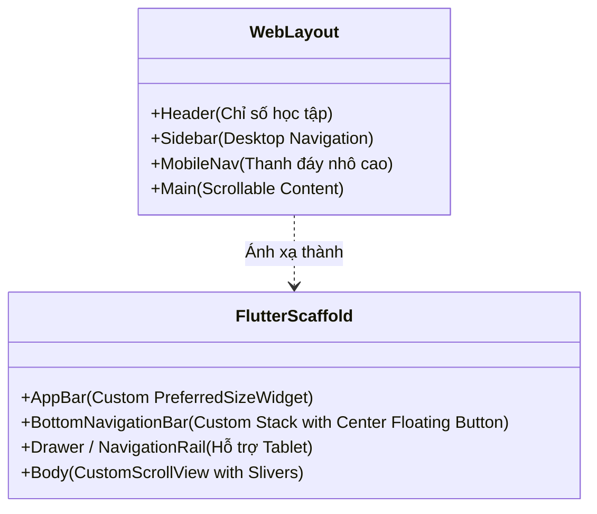

# COMPONENT MAPPING TABLE - WEB TO FLUTTER

> **Bảng ánh xạ chi tiết 1:1 từ React/Next.js UI Components sang Flutter Widgets**  
> Cung cấp hướng dẫn kỹ thuật cụ thể để đội ngũ phát triển Flutter xây dựng lại chính xác giao diện Web.

---

## 1. Danh Sách Thư Viện Tương Đương (Package Ecosystem Mapping)

| Thư Viện Web (`hub-el`) | Thư Viện Flutter Khuyên Dùng (`pub.dev`) | Mục Đích Sử Dụng |
| :--- | :--- | :--- |
| `lucide-react` | `lucide_icons: ^0.257.0` | Đồng bộ 100% hình thái icon vector với Web |
| `next-auth` (JWT) | `flutter_secure_storage: ^9.2.2` | Lưu Access Token, Refresh Token an toàn trong Keychain / Keystore |
| `axios` | `dio: ^5.4.3+1` | Gọi REST API, đính kèm Token Interceptor, tự động retry khi mạng chập chờn |
| `socket.io-client` | `socket_io_client: ^3.0.1` | Kết nối WebSocket thời gian thực cho tính năng Chat và Thông báo bạn bè |
| `recharts` | `fl_chart: ^0.68.0` | Vẽ biểu đồ tiến độ học tập, thời gian học theo tuần/tháng |
| `react-confetti` | `confetti: ^0.7.0` | Bắn hiệu ứng pháo hoa khi lên cấp hoặc nhận huy hiệu thành tựu |
| `react-avatar-editor`| `image_cropper: ^6.0.0` + `image_picker: ^1.1.2` | Chụp ảnh, chọn ảnh thư viện và cắt tròn ảnh đại diện |
| YouTube Iframe | `youtube_player_flutter: ^9.0.1` | Phát video YouTube trực tiếp không bị gián đoạn, hỗ trợ tua giây |
| `sonner` (Toast) | `toastification: ^2.1.0` hoặc `overlay_support` | Hiển thị thông báo nổi Toast Notification góc trên màn hình |
| CSS Shimmer Skeleton| `shimmer: ^3.0.0` | Hiệu ứng xương tải nội dung (Loading Skeleton) khi đang fetch dữ liệu |
| CSS 3D Transform | `flutter_flip_card: ^0.0.6` | Hiệu ứng lật thẻ bài Wiki 3D mượt mà 60 FPS |

---

## 2. Ánh Xạ Khung Giao Diện & Điều Hướng (Layout & Navigation)

| Component Web (`hub-el`) | Đường Dẫn Mã Nguồn | Widget Flutter Tương Đương | Lưu Ý Kỹ Thuật Khi Triển Khai Flutter |
| :--- | :--- | :--- | :--- |
| `MainLayout` | [`src/app/(main)/layout.tsx`](file:///d:/Coder/Web/hub-el/src/app/(main)/layout.tsx) | `Scaffold` | `Scaffold(bottomNavigationBar: MobileNavBar(), body: SafeArea(child: child))` |
| `Header` | [`src/components/layout/header.tsx`](file:///d:/Coder/Web/hub-el/src/components/layout/header.tsx) | `PreferredSizeWidget` / `SliverAppBar` | Custom AppBar chứa Logo, Search Icon, và hàng ngang các **ResourcePillWidget** (Streak, Energy, Coins, Gems). |
| `MobileNav` | [`src/components/layout/mobile-nav.tsx`](file:///d:/Coder/Web/hub-el/src/components/layout/mobile-nav.tsx) | `Stack` + `Container` | Thanh đáy cao 64px, riêng nút "Khóa học" dùng `Positioned(top: -20)` có đổ bóng tím để nhô cao vượt khung. |
| `Sidebar` | [`src/components/layout/sidebar.tsx`](file:///d:/Coder/Web/hub-el/src/components/layout/sidebar.tsx) | `NavigationRail` (Tablet) / `Drawer` (Phone) | Dùng khi người dùng mở App trên iPad hoặc thiết bị màn hình lớn. |
| `ThemeTogglePill` | [`src/components/layout/theme-toggle.tsx`](file:///d:/Coder/Web/hub-el/src/components/layout/theme-toggle.tsx) | `AnimatedContainer` / `Switch` | Chuyển đổi giữa `ThemeMode.light` và `ThemeMode.dark`. |

---

## 3. Ánh Xạ Component Theo Tính Năng (Feature Components)

### A. Nhóm Bảng Điều Khiển & Gamification (Dashboard & Quests)

| Component Web | Đường Dẫn Mã Nguồn | Widget Flutter Tương Đương | Chi Tiết Xây Dựng Flutter |
| :--- | :--- | :--- | :--- |
| `TaskItem` | [`src/components/features/dashboard/task-item.tsx`](file:///d:/Coder/Web/hub-el/src/components/features/dashboard/task-item.tsx) | `Card` / `InkWell` | Chứa Icon loại nhiệm vụ, tiêu đề, thanh `LinearProgressIndicator` (tiến độ $x/y$), và nút "Nhận thưởng" nếu hoàn thành. |
| `RecommendedVideoCard`| [`src/components/features/dashboard/recommended-video-card.tsx`](file:///d:/Coder/Web/hub-el/src/components/features/dashboard/recommended-video-card.tsx) | `Card` có bo góc `ClipRRect` | Ảnh thumbnail video tỉ lệ 16:9, thời lượng xem, tên kênh, lượt xem. |
| `StatsModal` | [`src/components/modals/stats-modal.tsx`](file:///d:/Coder/Web/hub-el/src/components/modals/stats-modal.tsx) | `showModalBottomSheet(isScrollControlled: true)` | Kéo vuốt từ dưới lên, render thống kê thời gian học bằng `fl_chart`. |
| `StatCard` | [`src/components/shared/stat-card.tsx`](file:///d:/Coder/Web/hub-el/src/components/shared/stat-card.tsx) | `Container` bo góc 16px | Nền mờ, chứa Icon có background hình tròn, con số hiển thị lớn và nhãn bên dưới. |

---

### B. Nhóm Thẻ Ngoại Ngữ Wiki & Gacha (Wiki & Cards)

| Component Web | Đường Dẫn Mã Nguồn | Widget Flutter Tương Đương | Chi Tiết Xây Dựng Flutter |
| :--- | :--- | :--- | :--- |
| `WikiCard3D` | [`src/components/ui/wiki-card-3d.tsx`](file:///d:/Coder/Web/hub-el/src/components/ui/wiki-card-3d.tsx) | `GestureDetector` + `Transform` (Matrix4) hoặc `FlipCard` | Mặt trước có viền phát sáng theo màu độ hiếm (R/SR/SSR/UR...), hàng ngôi sao thức tỉnh (`Row(children: [Icon(Icons.star)])`). Mặt sau chứa bài tóm tắt và từ vựng. |
| `GachaRollAnimation` | [`src/app/(main)/gacha/page.tsx`](file:///d:/Coder/Web/hub-el/src/app/(main)/gacha/page.tsx) | `AnimationController` + Lottie / Rive | Vòng tròn ma thuật xoay tròn, hiệu ứng nổ ánh sáng khi mở ra thẻ UR/SSR kèm rung điện thoại (`HapticFeedback.heavyImpact()`). |
| `ExchangeModal` | [`src/components/features/gacha/exchange-modal.tsx`](file:///d:/Coder/Web/hub-el/src/components/features/gacha/exchange-modal.tsx) | `AlertDialog` | Xem số lượng Bụi sao hiện có, danh sách lưới các thẻ chưa sở hữu và nút bấm "Đổi thẻ". |
| `StudyConfigDialog` | [`src/app/(main)/wiki/[id]/_components/StudyConfig.tsx`](file:///d:/Coder/Web/hub-el/src/app/(main)/wiki/[id]/_components/StudyConfig.tsx) | `showModalBottomSheet` | Thanh trượt `Slider` chọn số từ ($100 - 500$), `DropdownButton` chọn trình độ A1-C2, và checkbox các dạng câu hỏi. |

---

### C. Nhóm Trình Phát Video & Bài Tập AI (Video Player & Quizzes)

| Component Web | Đường Dẫn Mã Nguồn | Widget Flutter Tương Đương | Chi Tiết Xây Dựng Flutter |
| :--- | :--- | :--- | :--- |
| `VideoPlayerWrapper` | [`src/app/(main)/watch/[videoId]/page.tsx`](file:///d:/Coder/Web/hub-el/src/app/(main)/watch/[videoId]/page.tsx) | `YoutubePlayer` (`youtube_player_flutter`) | Bọc trong `OrientationBuilder` để tự động xoay ngang toàn màn hình khi người dùng xoay điện thoại. |
| `QuizPopupOverlay` | [`src/app/(main)/watch/[videoId]/page.tsx`](file:///d:/Coder/Web/hub-el/src/app/(main)/watch/[videoId]/page.tsx) | `Stack` + `AnimatedSlide` | Khi video chạm mốc `triggerAtSecond`, tạm dừng player (`controller.pause()`), trượt bảng câu hỏi lên màn hình. |
| `QuizOptionItem` | [`src/app/(main)/wiki/[id]/page.tsx`](file:///d:/Coder/Web/hub-el/src/app/(main)/wiki/[id]/page.tsx) | `AnimatedContainer` | Hiển thị 4 đáp án: Chạm vào đổi viền xanh/đỏ, đổi màu nền khi chọn đúng/sai kèm âm thanh phản hồi. |
| `VocabNotebookItem` | [`src/app/(main)/vocabulary/page.tsx`](file:///d:/Coder/Web/hub-el/src/app/(main)/vocabulary/page.tsx) | `ExpansionTile` hoặc `Card` | Hiển thị Từ mới, nút loa phát âm (`flutter_tts`), loại từ (N, V, ADJ), nghĩa tiếng Việt và ví dụ minh họa. |

---

### D. Nhóm Xã Hội & Trò Chuyện (Social & Realtime Chat)

| Component Web | Đường Dẫn Mã Nguồn | Widget Flutter Tương Đương | Chi Tiết Xây Dựng Flutter |
| :--- | :--- | :--- | :--- |
| `FriendListItem` | [`src/components/features/social/friend-list-item.tsx`](file:///d:/Coder/Web/hub-el/src/components/features/social/friend-list-item.tsx) | `ListTile` | Avatar có chấm xanh báo Online (`Stack` + `CircleAvatar` + chấm xanh 8px), tên hiển thị, nút Nhắn tin. |
| `ChatMessageBubble` | [`src/components/features/social/chat-message.tsx`](file:///d:/Coder/Web/hub-el/src/components/features/social/chat-message.tsx) | `Align` + `Container` | Phân biệt bong bóng tin nhắn của mình (`Alignment.centerRight`, nền xanh) và của bạn (`Alignment.centerLeft`, nền xám). |
| `GiftCardMessage` | [`src/components/features/social/chat-message.tsx`](file:///d:/Coder/Web/hub-el/src/components/features/social/chat-message.tsx#L403) | `Card` lấp lánh (Shimmer) | Tin nhắn hiển thị thành Hộp Quà Thẻ SSR, khi người nhận chạm vào sẽ hiện animation mở thẻ bài. |
| `ChatModals` | [`src/app/(main)/social/components/ChatModals.tsx`](file:///d:/Coder/Web/hub-el/src/app/(main)/social/components/ChatModals.tsx) | `showDialog` | Hộp thoại tạo nhóm chat mới, chọn thành viên từ danh sách bạn bè. |

---

### E. Nhóm Thành Tựu & Vinh Danh (Achievements & Leaderboard)

| Component Web | Đường Dẫn Mã Nguồn | Widget Flutter Tương Đương | Chi Tiết Xây Dựng Flutter |
| :--- | :--- | :--- | :--- |
| `AchievementCard` | [`src/app/(main)/achievements/page.tsx`](file:///d:/Coder/Web/hub-el/src/app/(main)/achievements/page.tsx) | `Container` bo góc 18px | Khung huy hiệu hiển thị màu theo Tier 1-6, icon huy hiệu, tiến độ mở khóa, nhãn phần thưởng XP/Xu/Năng lượng. |
| `GlobalAchievementToast`| [`src/components/features/achievements/achievement-toast.tsx`](file:///d:/Coder/Web/hub-el/src/components/features/achievements/achievement-toast.tsx)| `OverlayEntry` / `toastification` | Popup lơ lửng từ trên đỉnh màn hình rơi xuống khi mở khóa danh hiệu mới, tự tắt sau 4.5 giây. |
| `LeaderboardPodium` | [`src/app/(main)/leaderboard/page.tsx`](file:///d:/Coder/Web/hub-el/src/app/(main)/leaderboard/page.tsx) | `Row` chứa 3 cột bục vinh danh | Top 1 ở giữa (bục cao nhất, vương miện vàng), Top 2 bên trái (bạc), Top 3 bên phải (đồng). |
| `LeaderboardRow` | [`src/app/(main)/leaderboard/page.tsx`](file:///d:/Coder/Web/hub-el/src/app/(main)/leaderboard/page.tsx) | `ListTile` | Số thứ tự Rank, avatar học viên có tag `PRO`, tên học viên, điểm số và số liệu chi tiết. |

