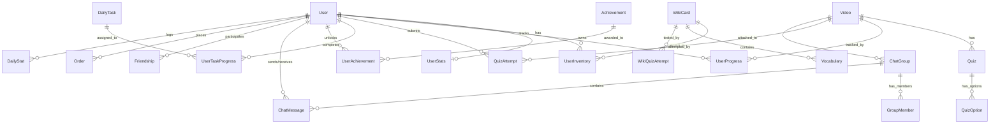

# DATABASE & ENTITY MAPPING - HUB-EL

> **Tài liệu phân tích cấu trúc cơ sở dữ liệu Prisma (SQL Server) và ánh xạ sang Dart Data Models cho Flutter**  
> Căn cứ từ schema gốc tại [`hub-el/prisma/schema.prisma`](file:///d:/Coder/Web/hub-el/prisma/schema.prisma)

---

## 1. Sơ Đồ Quan Hệ Thực Thể Cốt Lõi (Entity-Relationship Diagram)

---

## 2. Bảng Phân Tích Thực Thể CSDL & Ánh Xạ Sang Flutter Dart Models

### A. Thực thể Người Dùng & Gamification (User & UserStats)

#### 1. Bảng `users` $\rightarrow$ Model `UserModel` / `UserEntity`
- **Tập tin Dart đích:** `lib/features/auth/domain/entities/user_entity.dart`
- **Mục đích:** Lưu trữ định danh, thông tin hiển thị, chỉ số kinh tế và Streak.

| Cột CSDL (Prisma) | Kiểu Dữ Liệu SQL | Thuộc Tính Dart (Flutter) | Kiểu Dart | Ghi Chú & Lưu Ý Bảo Mật |
| :--- | :--- | :--- | :--- | :--- |
| `id` | `String (cuid)` | `id` | `String` | Khóa chính duy nhất. |
| `email` | `String (unique)` | `email` | `String` | Email đăng nhập. |
| `name` | `String?` | `name` | `String?` | Tên hiển thị của học viên. |
| `image` | `String? (Max)` | `image` | `String?` | URL ảnh đại diện Google/OAuth. |
| `avatar` | `String?` | `avatar` | `String?` | URL ảnh avatar tùy chỉnh. |
| `password` | `String?` | **KHÔNG ÁNH XẠ** | - | **BẢO MẬT:** Tuyệt đối không trả mật khẩu mã hóa về Mobile. |
| `role` | `String` | `role` | `String` | `'student'`, `'teacher'`, `'admin'`, `'banned'`. |
| `isActive` | `Boolean` | `isActive` | `bool` | Trạng thái tài khoản. |
| `level` | `Int` | `level` | `int` | Cấp độ học tập (Bắt đầu từ 1). |
| `xp` | `Int` | `xp` | `int` | Điểm kinh nghiệm hiện có của cấp hiện tại. |
| `freeCoins` | `Int` | `freeCoins` | `int` | Xu Gacha dùng quay thẻ & cứu sao. |
| `aiTokens` | `Int` | `aiTokens` | `int` | Năng lượng dùng tạo bài đọc & Quiz AI. |
| `premiumCoins` | `Int` | `premiumCoins` | `int` | Ngọc nạp bằng tiền MoMo. |
| `stardust` | `Int` | `stardust` | `int` | Bụi sao tái chế từ thẻ trùng. |
| `pitySR` / `SSR` / `UR`| `Int` | `pitySR`, `pitySSR`, `pityUR` | `int` | Các bộ đếm bảo hiểm vòng quay Gacha. |
| `isPro` | `Boolean` | `isPro` | `bool` | Cờ tài khoản VIP. |
| `premiumExpiresAt` | `DateTime?` | `premiumExpiresAt` | `DateTime?` | Thời điểm hết hạn gói VIP. |
| `currentStreak` | `Int` | `currentStreak` | `int` | Chuỗi ngày học liên tục hiện tại. |
| `highestStreak` | `Int` | `highestStreak` | `int` | Kỷ lục chuỗi ngày học dài nhất. |
| `streakFreezes` | `Int` | `streakFreezes` | `int` | Số thẻ bảo vệ chuỗi đang có (tối đa 2). |
| `lastStudyDate` | `DateTime?` | `lastStudyDate` | `DateTime?` | Mốc ngày học gần nhất để kiểm tra đứt chuỗi. |
| `targetLanguage` | `String?` | `targetLanguage` | `String?` | Ngôn ngữ mục tiêu (`"en"`, `"ja"`, `"ko"`...). |
| `languageLevel` | `String?` | `languageLevel` | `String?` | Trình độ mong muốn (`"A1"` đến `"C2"`). |
| `interests` | `NVarChar(Max)` | `interests` | `List<String>` | **JSON Decode:** Danh sách chủ đề sở thích. |
| `privacySettings` | `NVarChar(Max)` | `privacySettings` | `PrivacySettingsModel?` | **JSON Decode:** Cấu hình ẩn kho đồ, trạng thái online. |
| `notificationSettings`| `NVarChar(Max)` | `notificationSettings` | `NotificationSettingsModel?` | **JSON Decode:** Cấu hình nhận thông báo & email. |

---

#### 2. Bảng `user_stats` $\rightarrow$ Model `UserStatsModel`
- **Tập tin Dart đích:** `lib/features/dashboard/data/models/user_stats_model.dart`
- **Mục đích:** Dữ liệu cho modal báo cáo thống kê và bảng xếp hạng.

| Cột CSDL (Prisma) | Kiểu Dữ Liệu SQL | Thuộc Tính Dart | Kiểu Dart | Ý Nghĩa Nghiệp Vụ |
| :--- | :--- | :--- | :--- | :--- |
| `totalVideoWatched` | `Int` | `totalVideoWatched` | `int` | Tổng số video đã xem xong. |
| `totalStudySeconds` | `Int` | `totalStudySeconds` | `int` | Tổng thời lượng học (Tính bằng giây). |
| `correctQuizAnswers`| `Int` | `correctQuizAnswers` | `int` | Tổng số câu Quiz đã trả lời đúng. |
| `totalQuizAttempts` | `Int` | `totalQuizAttempts` | `int` | Tổng số lần làm bài trắc nghiệm. |
| `learnedWordsCount` | `Int` | `learnedWordsCount` | `int` | Tổng số từ vựng mới đã học. |
| `totalGachaPulls` | `Int` | `totalGachaPulls` | `int` | Tổng số lượt bấm quay thẻ. |
| `sharedCardsCount` | `Int` | `sharedCardsCount` | `int` | Số lần share thẻ cho bạn bè. |
| `messagesSentCount` | `Int` | `messagesSentCount` | `int` | Tổng số tin nhắn đã gửi trong chat. |
| `totalCoinsSpent` | `Int` | `totalCoinsSpent` | `int` | Tổng số Xu Gacha đã tiêu. |
| `totalAiEnergySpent`| `Int` | `totalAiEnergySpent` | `int` | Tổng năng lượng AI đã sử dụng. |

---

### B. Thực thể Thẻ Bài Ngoại Ngữ Wiki & Tủ Đồ (WikiCard & Inventory)

#### 1. Bảng `wiki_cards` $\rightarrow$ Model `WikiCardModel`
- **Tập tin Dart đích:** `lib/features/wiki_learning/data/models/wiki_card_model.dart`

| Cột CSDL (Prisma) | Kiểu Dữ Liệu SQL | Thuộc Tính Dart | Kiểu Dart | Xử Lý Dữ Liệu Trên Mobile |
| :--- | :--- | :--- | :--- | :--- |
| `id` | `Int` | `id` | `int` | ID thẻ bài. |
| `title` | `NVarChar(255)` | `title` | `String` | Tiêu đề thẻ (VD: "Thuyết Tương Đối"). |
| `rarity` | `String` | `rarity` | `String` | Độ hiếm: `'N'`, `'R'`, `'SR'`, `'SSR'`, `'UR'`, `'LR'`, `'MR'`. |
| `imageUrl` | `String?` | `imageUrl` | `String?` | Link ảnh minh họa thẻ bài. |
| `totalStars` | `Int` | `totalStars` | `int` | Số sao tối đa của thẻ (1 đến 7 sao). |
| `awakenedStars` | `Int` | `awakenedStars` | `int` | Số sao đã thức tỉnh hiện tại. |
| `aiContent` | `NVarChar(Max)` | `aiContent` | `WikiLessonDataModel?` | **JSON Decode:** Chứa bài đọc đã tóm tắt và danh sách câu hỏi AI. |
| `chunkData` | `NVarChar(Max)` | `chunkData` | `List<String>?` | **JSON Decode:** Các mẩu văn bản dùng làm prompt cho AI. |

#### 2. Bảng `user_inventory` $\rightarrow$ Model `UserInventoryModel`
- **Tập tin Dart đích:** `lib/features/wiki_learning/data/models/user_inventory_model.dart`
- **Mục đích:** Tủ đồ cá nhân lưu các thẻ bài đã quay trúng hoặc được tặng.

| Cột CSDL (Prisma) | Kiểu Dữ Liệu SQL | Thuộc Tính Dart | Kiểu Dart | Ý Nghĩa Nghiệp Vụ |
| :--- | :--- | :--- | :--- | :--- |
| `id` | `Int` | `id` | `int` | Khóa chính kho đồ. |
| `cardId` | `Int` | `cardId` | `int` | Khóa ngoại trỏ về `WikiCard`. |
| `acquiredAt` | `DateTime` | `acquiredAt` | `DateTime` | Thời điểm quay trúng thẻ. |
| `isNew` | `Boolean` | `isNew` | `bool` | Cờ hiển thị chấm đỏ "Mới nhận" trên UI. |
| `currentStar` | `Int` | `currentStar` | `int` | Tiến độ học của người dùng trên thẻ này. |
| `canShareCount` | `Int` | `canShareCount` | `int` | Số lần được tặng thẻ này cho bạn bè (Mặc định 1). |
| `source` | `String` | `source` | `String` | Nguồn thẻ: `'GACHA'` hoặc `'SHARED'`. |
| `isCompleted` | `Boolean` | `isCompleted` | `bool` | Đã học Full Sao thẻ này chưa. |
| `card` | `WikiCard?` | `card` | `WikiCardModel?` | Thực thể thẻ bài lồng nhau (Relation Include). |

#### 3. Bảng `vocabularies` $\rightarrow$ Model `VocabularyModel`
- **Tập tin Dart đích:** `lib/features/vocabulary/data/models/vocabulary_model.dart`

| Cột CSDL (Prisma) | Kiểu Dữ Liệu SQL | Thuộc Tính Dart | Kiểu Dart | Ý Nghĩa |
| :--- | :--- | :--- | :--- | :--- |
| `id` | `Int` | `id` | `int` | Khóa chính từ vựng. |
| `word` | `NVarChar(255)` | `word` | `String` | Từ vựng tiếng nước ngoài. |
| `pos` | `String?` | `pos` | `String?` | Loại từ (N, V, ADJ, ADV...). |
| `meaning` | `NVarChar(500)` | `meaning` | `String` | Nghĩa tiếng Việt. |
| `englishDesc` | `NVarChar(Max)` | `englishDesc` | `String?` | Dòng 1: Phiên âm bồi; Dòng 2: Ngữ cảnh giải thích. |
| `language` | `String?` | `language` | `String?` | Ngôn ngữ học tập. |

---

### C. Thực thể Video Học Tập & Trắc Nghiệm AI (Video & Quiz)

#### 1. Bảng `videos` $\rightarrow$ Model `VideoModel`
- **Tập tin Dart đích:** `lib/features/video_learning/data/models/video_model.dart`

| Cột CSDL (Prisma) | Kiểu Dữ Liệu SQL | Thuộc Tính Dart | Kiểu Dart | Ý Nghĩa |
| :--- | :--- | :--- | :--- | :--- |
| `id` | `Int` | `id` | `int` | ID video trong DB. |
| `youtubeUrl` | `String (unique)` | `youtubeUrl` | `String` | Link YouTube gốc. |
| `title` | `NVarChar(255)` | `title` | `String` | Tiêu đề video. |
| `channelName` | `NVarChar(255)` | `channelName` | `String` | Tên kênh đăng tải. |
| `thumbnail` | `NVarChar(500)` | `thumbnail` | `String` | Link URL ảnh bìa. |
| `duration` | `Int` | `duration` | `int` | Thời lượng video tính bằng giây. |

#### 2. Bảng `quizzes` & `quiz_options` $\rightarrow$ Model `QuizModel` & `QuizOptionModel`
- **Tập tin Dart đích:** `lib/features/video_learning/data/models/quiz_model.dart`

| Cột CSDL (Prisma) | Kiểu Dữ Liệu SQL | Thuộc Tính Dart | Kiểu Dart | Ý Nghĩa |
| :--- | :--- | :--- | :--- | :--- |
| `id` | `Int` | `id` | `int` | ID câu hỏi. |
| `triggerAtSecond`| `Int` | `triggerAtSecond`| `int` | Giây thứ mấy sẽ tạm dừng video để hiện popup Quiz. |
| `question` | `NVarChar(Max)` | `question` | `String` | Nội dung câu hỏi AI sinh. |
| `explanation` | `NVarChar(Max)` | `explanation` | `String?` | Lời giải thích chi tiết. |
| `options` | `QuizOption[]` | `options` | `List<QuizOptionModel>` | Danh sách các phương án A, B, C, D kèm cờ `isCorrect`. |

---

### D. Thực thể Nhiệm Vụ Ngày & Bảng Xếp Hạng (DailyTask & DailyStat)

#### 1. Bảng `daily_tasks` & `user_task_progress` $\rightarrow$ Model `DailyTaskModel`
- **Tập tin Dart đích:** `lib/features/dashboard/data/models/daily_task_model.dart`

| Thuộc Tính Dart | Kiểu Dart | Nguồn Cột CSDL | Ý Nghĩa Nghiệp Vụ |
| :--- | :--- | :--- | :--- |
| `id` | `int` | `daily_tasks.id` | ID nhiệm vụ. |
| `taskDesc` | `String` | `daily_tasks.taskDesc` | Mô tả hiển thị trên UI (VD: "Hoàn thành 1 bài Quiz"). |
| `taskType` | `String` | `daily_tasks.taskType` | Mã logic: `'GACHA'`, `'QUIZ'`, `'WATCH'`, `'ROLL_GACHA'`. |
| `target` | `int` | `daily_tasks.target` | Mục tiêu cần đạt (VD: 3 video). |
| `current` | `int` | `user_task_progress.current`| Tiến độ người dùng đã làm được hôm nay. |
| `rewardCoins` | `int` | `daily_tasks.rewardCoins` | Số Xu Gacha thưởng. |
| `rewardXp` | `int` | `daily_tasks.rewardXp` | Số XP kinh nghiệm thưởng. |
| `isClaimed` | `bool` | `user_task_progress.isClaimed` | Đã bấm nút nhận thưởng chưa. |
| `isProOnly` | `bool` | `daily_tasks.isProOnly` | Nhiệm vụ độc quyền cho tài khoản PRO. |

#### 2. Bảng `daily_stats` $\rightarrow$ Model `DailyStatModel`
- **Mục đích:** Bảng ghi nhận chỉ số theo từng ngày (Date không có giờ) để phục vụ xếp hạng Tuần/Tháng/Năm.
- Các chỉ số: `xpGained`, `studySeconds`, `correctAnswers`, `quizAttempts`.

---

### E. Thực thể Cộng Đồng & Chat (Friendship & ChatMessage)

#### 1. Bảng `friendships` $\rightarrow$ Model `FriendshipModel`
- Các trạng thái quan hệ: `'PENDING'` (Chờ đồng ý), `'ACCEPTED'` (Đã là bạn), `'BLOCKED'` (Đã chặn).

#### 2. Bảng `chat_messages` $\rightarrow$ Model `ChatMessageModel`
- **Tập tin Dart đích:** `lib/features/social/data/models/chat_message_model.dart`

| Thuộc Tính Dart | Kiểu Dart | Cột Prisma | Ý Nghĩa |
| :--- | :--- | :--- | :--- |
| `id` | `int` | `chat_messages.id` | ID tin nhắn. |
| `senderId` | `String` | `senderId` | Người gửi. |
| `receiverId` | `String?` | `receiverId` | Người nhận (nếu chat 1-1). |
| `groupId` | `int?` | `groupId` | ID nhóm (nếu chat nhóm / box video). |
| `content` | `String` | `content` | Nội dung văn bản tin nhắn. |
| `messageType` | `String` | `messageType` | `'TEXT'`, `'IMAGE'`, `'WIKI_CARD'`, `'SHARE_VIDEO'`. |
| `fileUrl` | `String?` | `fileUrl` | Link URL ảnh hoặc link thẻ Wiki đính kèm. |
| `isGiftCard` | `bool` | `isGiftCard` | Cờ render tin nhắn thành **Hộp Quà Thẻ SSR** lấp lánh. |
| `createdAt` | `DateTime` | `createdAt` | Thời gian gửi tin. |

---

### F. Thực thể Hóa Đơn & MoMo (Order & SubscriptionPlan)

#### Bảng `orders` $\rightarrow$ Model `OrderModel`
- Lưu trữ `orderCode` (VD: `HUBEL_1714800000_1234`), `amount` (VND), `status` (`'PENDING'`, `'SUCCESS'`, `'FAILED'`), `type` (`'VIP'` hoặc `'COIN'`).

