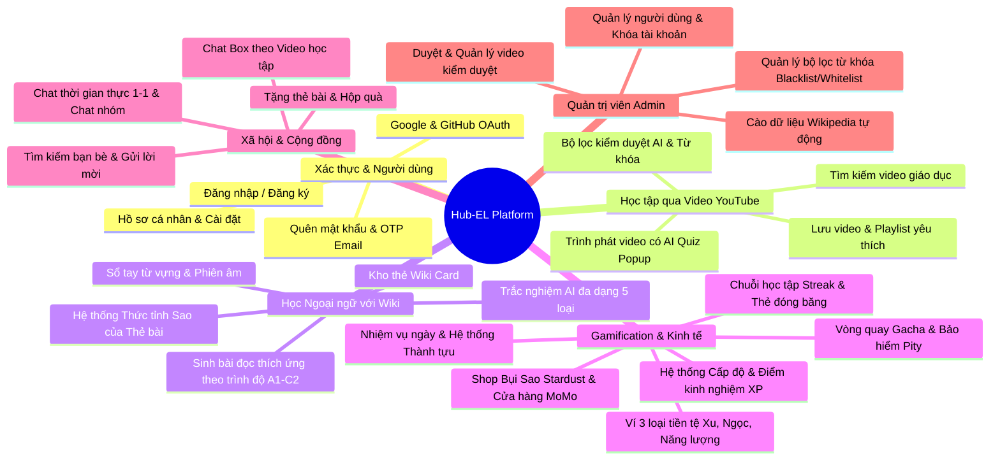

# FEATURE INVENTORY - HUB-EL

> **Bảng kiểm kê toàn bộ tính năng và chức năng của ứng dụng Web Hub-EL**  
> Dùng làm danh mục chuẩn để đối chiếu 1:1 khi phát triển Flutter Mobile App.

---

## 1. Phân nhóm Tính năng Cốt lõi (Core Feature Modules)

---

## 2. Chi tiết Từng Tính năng & Căn cứ Mã Nguồn (Source Code Mapping)

### Module 1: Xác thực & Quản lý Người dùng (Auth & User Profile)

| STT | Tính năng | Mô tả chức năng | Căn cứ mã nguồn Web (`hub-el`) |
| :--- | :--- | :--- | :--- |
| 1.1 | **Đăng nhập Credentials** | Đăng nhập bằng Email và Password, mã hóa bcrypt, chặn tài khoản bị BANNED. | [`src/app/(auth)/login/page.tsx`](file:///d:/Coder/Web/hub-el/src/app/(auth)/login/page.tsx), [`src/lib/auth.ts`](file:///d:/Coder/Web/hub-el/src/lib/auth.ts#L35-L67) |
| 1.2 | **Đăng ký tài khoản** | Đăng ký tài khoản mới bằng Email/Mật khẩu/Tên, khởi tạo UserStats mặc định. | [`src/app/(auth)/register/page.tsx`](file:///d:/Coder/Web/hub-el/src/app/(auth)/register/page.tsx), [`src/actions/auth/register.ts`](file:///d:/Coder/Web/hub-el/src/actions/auth/register.ts) |
| 1.3 | **Đăng nhập OAuth** | Đăng nhập một chạm bằng Google hoặc GitHub. | [`src/components/sign-in.tsx`](file:///d:/Coder/Web/hub-el/src/components/sign-in.tsx), [`src/lib/auth.ts`](file:///d:/Coder/Web/hub-el/src/lib/auth.ts#L22-L34) |
| 1.4 | **Quên mật khẩu & OTP** | Gửi mã OTP 6 số qua email xác thực để tạo lại mật khẩu mới. | [`src/app/forgot-password/page.tsx`](file:///d:/Coder/Web/hub-el/src/app/forgot-password/page.tsx), [`src/actions/auth/reset.ts`](file:///d:/Coder/Web/hub-el/src/actions/auth/reset.ts) |
| 1.5 | **Trang cá nhân (Profile)** | Hiển thị thông tin học viên, cấp độ, huy hiệu, lịch sử thẻ bài và thống kê. | [`src/app/(main)/profile/[id]/page.tsx`](file:///d:/Coder/Web/hub-el/src/app/(main)/profile/[id]/page.tsx) |
| 1.6 | **Cài đặt hồ sơ & Mật khẩu** | Cập nhật tên, ảnh đại diện, tiểu sử, mật khẩu và liên kết mạng xã hội. | [`src/app/(main)/settings/page.tsx`](file:///d:/Coder/Web/hub-el/src/app/(main)/settings/page.tsx), [`src/app/(main)/settings/components/ProfileTab.tsx`](file:///d:/Coder/Web/hub-el/src/app/(main)/settings/components/ProfileTab.tsx), [`src/app/(main)/settings/components/SecurityTab.tsx`](file:///d:/Coder/Web/hub-el/src/app/(main)/settings/components/SecurityTab.tsx) |
| 1.7 | **Cài đặt quyền riêng tư** | Bật/tắt hiển thị trạng thái online, ẩn kho thẻ bài, ẩn lịch sử học. | [`src/app/(main)/settings/components/PrivacyTab.tsx`](file:///d:/Coder/Web/hub-el/src/app/(main)/settings/components/PrivacyTab.tsx), [`src/actions/user/settings.ts`](file:///d:/Coder/Web/hub-el/src/actions/user/settings.ts) |
| 1.8 | **Cài đặt thông báo** | Quản lý nhận email thông báo kết bạn, nhắc nhở nhiệm vụ hàng ngày. | [`src/app/(main)/settings/components/NotificationsTab.tsx`](file:///d:/Coder/Web/hub-el/src/app/(main)/settings/components/NotificationsTab.tsx) |

---

### Module 2: Dashboard & Nhiệm vụ Ngày (Dashboard & Quests)

| STT | Tính năng | Mô tả chức năng | Căn cứ mã nguồn Web (`hub-el`) |
| :--- | :--- | :--- | :--- |
| 2.1 | **Thanh chỉ số học tập (Header Stats)** | Hiển thị Cấp độ, tiến độ XP, Streak, Năng lượng AI, Xu Gacha, Ngọc nạp. | [`src/components/layout/header.tsx`](file:///d:/Coder/Web/hub-el/src/components/layout/header.tsx), [`src/actions/user/learning.ts`](file:///d:/Coder/Web/hub-el/src/actions/user/learning.ts) |
| 2.2 | **Nhiệm vụ hằng ngày (Daily Quests)** | Danh sách nhiệm vụ (Xem video, làm Quiz, quay Gacha, task Pro) & nhận thưởng Xu/XP. | [`src/components/features/dashboard/task-item.tsx`](file:///d:/Coder/Web/hub-el/src/components/features/dashboard/task-item.tsx), [`src/actions/quests/progress.ts`](file:///d:/Coder/Web/hub-el/src/actions/quests/progress.ts) |
| 2.3 | **Video đề xuất (Recommended Videos)** | Đề xuất các video học tập chất lượng cao dựa theo sở thích người dùng. | [`src/components/features/dashboard/recommended-video-card.tsx`](file:///d:/Coder/Web/hub-el/src/components/features/dashboard/recommended-video-card.tsx) |
| 2.4 | **Modal Thống kê Học tập** | Xem tổng quan thời gian học, số video đã xem, câu đúng, tỷ lệ trả lời đúng. | [`src/components/modals/stats-modal.tsx`](file:///d:/Coder/Web/hub-el/src/components/modals/stats-modal.tsx), [`src/actions/stats.ts`](file:///d:/Coder/Web/hub-el/src/actions/stats.ts) |

---

### Module 3: Khóa học, Video YouTube & Trắc nghiệm AI (Video Learning & AI Quiz)

| STT | Tính năng | Mô tả chức năng | Căn cứ mã nguồn Web (`hub-el`) |
| :--- | :--- | :--- | :--- |
| 3.1 | **Tìm kiếm Video Giáo dục** | Tìm kiếm video YouTube có xếp hạng phù hợp ngữ cảnh giáo dục. | [`src/app/(main)/explore/page.tsx`](file:///d:/Coder/Web/hub-el/src/app/(main)/explore/page.tsx), [`src/actions/video/video.ts`](file:///d:/Coder/Web/hub-el/src/actions/video/video.ts#L47-L70) |
| 3.2 | **Bộ lọc kiểm duyệt (Educational Filter)** | Tự động loại bỏ nội dung rác/giải trí bằng Blacklist/Whitelist và Gemini AI. | [`src/actions/video/video.ts`](file:///d:/Coder/Web/hub-el/src/actions/video/video.ts#L32-L42), [`src/lib/video/youtube.ts`](file:///d:/Coder/Web/hub-el/src/lib/video/youtube.ts#L5-L28) |
| 3.3 | **Dán Link YouTube trực tiếp** | Cho phép người dùng dán URL YouTube bất kỳ, kiểm tra tính giáo dục trước khi xem. | [`src/components/layout/header.tsx`](file:///d:/Coder/Web/hub-el/src/components/layout/header.tsx#L162-L200) |
| 3.4 | **Trình phát Video & Lưu tiến độ** | Phát video YouTube, lưu lại giây xem dở (`lastWatched`) để tua tiếp lần sau. | [`src/app/(main)/watch/[videoId]/page.tsx`](file:///d:/Coder/Web/hub-el/src/app/(main)/watch/[videoId]/page.tsx), [`src/actions/video/progress.ts`](file:///d:/Coder/Web/hub-el/src/actions/video/progress.ts) |
| 3.5 | **Tạo Quiz từ Video bằng Gemini AI** | Tự động bóc tách phụ đề (`youtube-transcript`) và nhờ Gemini sinh 5 câu hỏi trắc nghiệm dừng video kiểm tra. | [`src/actions/quiz/ai.ts`](file:///d:/Coder/Web/hub-el/src/actions/quiz/ai.ts), [`src/lib/quiz/gemini.ts`](file:///d:/Coder/Web/hub-el/src/lib/quiz/gemini.ts) |
| 3.6 | **Khóa học & Danh sách phát đã lưu** | Quản lý danh sách video và playlist YouTube yêu thích. | [`src/app/(main)/courses/page.tsx`](file:///d:/Coder/Web/hub-el/src/app/(main)/courses/page.tsx), [`src/app/(main)/playlist/[playlistId]/page.tsx`](file:///d:/Coder/Web/hub-el/src/app/(main)/playlist/[playlistId]/page.tsx), [`src/actions/video/favorite.ts`](file:///d:/Coder/Web/hub-el/src/actions/video/favorite.ts) |
| 3.7 | **Lịch sử làm bài trắc nghiệm (Quiz Review)**| Xem lại bài thi cũ, thống kê câu đúng/sai và lời giải thích của AI. | [`src/app/(main)/quizzes/page.tsx`](file:///d:/Coder/Web/hub-el/src/app/(main)/quizzes/page.tsx), [`src/app/(main)/quizzes/review/page.tsx`](file:///d:/Coder/Web/hub-el/src/app/(main)/quizzes/review/page.tsx), [`src/actions/quiz/attempt.ts`](file:///d:/Coder/Web/hub-el/src/actions/quiz/attempt.ts) |

---

### Module 4: Ngoại ngữ với Wiki & Gacha (Wiki Language Learning & Gacha)

| STT | Tính năng | Mô tả chức năng | Căn cứ mã nguồn Web (`hub-el`) |
| :--- | :--- | :--- | :--- |
| 4.1 | **Thư viện Thẻ Wiki (Wiki Manager)** | Quản lý kho thẻ bài đã thu thập, lọc theo độ hiếm (N, R, SR, SSR, UR, LR, MR) và trạng thái hoàn thành. | [`src/app/(main)/wiki-manager/page.tsx`](file:///d:/Coder/Web/hub-el/src/app/(main)/wiki-manager/page.tsx), [`src/actions/wiki-manager.ts`](file:///d:/Coder/Web/hub-el/src/actions/wiki-manager.ts) |
| 4.2 | **Cấu hình học tập AI (Study Config)** | Cho phép chọn số lượng câu hỏi, số lượng từ đọc, cấp độ ngôn ngữ (A1-C2), ngôn ngữ mục tiêu (En, Ja, Ko...). | [`src/app/(main)/wiki/[id]/_components/StudyConfig.tsx`](file:///d:/Coder/Web/hub-el/src/app/(main)/wiki/[id]/_components/StudyConfig.tsx) |
| 4.3 | **Sinh bài đọc & Câu hỏi thông minh** | Gemini cào bài Wikipedia, băm nhỏ chunk, viết lại bài đọc và tạo câu hỏi đa dạng (Multiple Choice, True/False, Main Idea, Inference, Guess Meaning). | [`src/app/(main)/wiki/[id]/page.tsx`](file:///d:/Coder/Web/hub-el/src/app/(main)/wiki/[id]/page.tsx), [`src/actions/quiz.ts`](file:///d:/Coder/Web/hub-el/src/actions/quiz.ts#L58-L376) |
| 4.4 | **Hệ thống Thức tỉnh Sao (Awakening)** | Thi đạt điểm đậu -> Tăng 1 sao (tối đa theo độ hiếm thẻ); Thi trượt -> Rớt 1 sao. | [`src/actions/quiz.ts`](file:///d:/Coder/Web/hub-el/src/actions/quiz.ts#L387-L410) |
| 4.5 | **Bảo vệ sao bằng Xu (Keep Star)** | Tiêu 50 Xu Gacha để phục hồi sao khi thi rớt. | [`src/actions/quiz.ts`](file:///d:/Coder/Web/hub-el/src/actions/quiz.ts#L493-L520) |
| 4.6 | **Vòng quay Gacha Thẻ bài** | Tiêu 100 Xu để quay thẻ Wiki ngẫu nhiên theo tỷ lệ; Tài khoản PRO được 1 lượt quay miễn phí/ngày. | [`src/app/(main)/gacha/page.tsx`](file:///d:/Coder/Web/hub-el/src/app/(main)/gacha/page.tsx), [`src/actions/gacha.ts`](file:///d:/Coder/Web/hub-el/src/actions/gacha.ts#L16-L140) |
| 4.7 | **Hệ thống Bảo hiểm Pity Gacha** | Cơ chế bảo hiểm chắc chắn ra thẻ hiếm: 10 lần ra SR, 50 lần ra SSR, 120 lần ra UR. | [`src/actions/gacha.ts`](file:///d:/Coder/Web/hub-el/src/actions/gacha.ts#L35-L53) |
| 4.8 | **Đổi Bụi sao (Stardust Exchange)** | Quay trùng thẻ tự động chuyển thành Bụi sao (+20% cho PRO) để đổi các thẻ bài chưa sở hữu. | [`src/components/features/gacha/exchange-modal.tsx`](file:///d:/Coder/Web/hub-el/src/components/features/gacha/exchange-modal.tsx), [`src/actions/gacha.ts`](file:///d:/Coder/Web/hub-el/src/actions/gacha.ts#L180-L210) |
| 4.9 | **Sổ tay Từ vựng (Vocabulary)** | Trích xuất từ mới tự động có phiên âm, loại từ, nghĩa tiếng Việt và bối cảnh sử dụng. | [`src/app/(main)/vocabulary/page.tsx`](file:///d:/Coder/Web/hub-el/src/app/(main)/vocabulary/page.tsx), [`src/actions/vocabulary.ts`](file:///d:/Coder/Web/hub-el/src/actions/vocabulary.ts) |

---

### Module 5: Cộng đồng & Mạng xã hội (Social & Realtime Chat)

| STT | Tính năng | Mô tả chức năng | Căn cứ mã nguồn Web (`hub-el`) |
| :--- | :--- | :--- | :--- |
| 5.1 | **Tìm kiếm & Kết bạn** | Tìm kiếm học viên theo tên/ID, gửi lời mời kết bạn, hủy lời mời, chặn (Block) người dùng. | [`src/actions/social/social.ts`](file:///d:/Coder/Web/hub-el/src/actions/social/social.ts#L8-L121) |
| 5.2 | **Quản lý Danh sách Bạn bè & Lời mời**| Xem danh sách lời mời đang chờ (`PENDING`), đồng ý/từ chối, xem danh sách bạn bè đã kết nối. | [`src/actions/social/social.ts`](file:///d:/Coder/Web/hub-el/src/actions/social/social.ts#L123-L210) |
| 5.3 | **Chat thời gian thực 1-1** | Nhắn tin văn bản, gửi file ảnh, Socket.io cập nhật tin nhắn tức thì. | [`src/app/(main)/social/page.tsx`](file:///d:/Coder/Web/hub-el/src/app/(main)/social/page.tsx), [`src/components/features/social/chat-message.tsx`](file:///d:/Coder/Web/hub-el/src/components/features/social/chat-message.tsx), [`src/actions/social/social.ts`](file:///d:/Coder/Web/hub-el/src/actions/social/social.ts#L232-L245) |
| 5.4 | **Chat nhóm (Group Chat)** | Tạo nhóm trò chuyện, mời thành viên, đổi tên nhóm/avatar nhóm, rời nhóm. | [`src/app/(main)/social/components/ChatModals.tsx`](file:///d:/Coder/Web/hub-el/src/app/(main)/social/components/ChatModals.tsx), [`src/actions/social/social.ts`](file:///d:/Coder/Web/hub-el/src/actions/social/social.ts#L250-L380) |
| 5.5 | **Phòng Chat theo Video** | Box chat gắn liền với từng video học tập để người xem cùng thảo luận bài học. | [`src/actions/social/social.ts`](file:///d:/Coder/Web/hub-el/src/actions/social/social.ts#L400-L460) |
| 5.6 | **Tặng Thẻ bài Wiki (Gift Card)** | Chia sẻ thẻ SSR/UR dưới dạng tin nhắn Hộp Quà (Gift Card) kèm email thông báo cho người nhận. | [`src/components/modals/ShareVideoModal.tsx`](file:///d:/Coder/Web/hub-el/src/components/modals/ShareVideoModal.tsx), [`src/actions/social/social.ts`](file:///d:/Coder/Web/hub-el/src/actions/social/social.ts#L232-L240) |

---

### Module 6: Vinh danh & Thành tựu (Leaderboard & Achievements)

| STT | Tính năng | Mô tả chức năng | Căn cứ mã nguồn Web (`hub-el`) |
| :--- | :--- | :--- | :--- |
| 6.1 | **Bảng xếp hạng Đa danh mục** | 4 bảng đua top: Chuỗi học (`STREAK`), Siêu cày cuốc (`GRINDER` - XP), Thời lượng xem (`TIME`), Sát thủ AI (`AI_KILLER` - Câu đúng). | [`src/app/(main)/leaderboard/page.tsx`](file:///d:/Coder/Web/hub-el/src/app/(main)/leaderboard/page.tsx), [`src/actions/leaderboard.ts`](file:///d:/Coder/Web/hub-el/src/actions/leaderboard.ts#L95-L215) |
| 6.2 | **Khung thời gian linh hoạt** | Xem top theo Ngày (`DAY`), Tuần (`WEEK`), Tháng (`MONTH`) và Toàn thời gian (`ALL`). | [`src/actions/leaderboard.ts`](file:///d:/Coder/Web/hub-el/src/actions/leaderboard.ts#L74-L93) |
| 6.3 | **Hệ thống Thành tựu 6 Hạng (Tiers)** | Gồm 50+ huy hiệu chia theo nhóm: Streak, Level, Video, Quiz, Vocab, Gacha, Stardust, Kinh tế. | [`src/app/(main)/achievements/page.tsx`](file:///d:/Coder/Web/hub-el/src/app/(main)/achievements/page.tsx), [`src/config/achievements.ts`](file:///d:/Coder/Web/hub-el/src/config/achievements.ts#L13-L108) |
| 6.4 | **Danh hiệu Ẩn (Easter Eggs)** | Các thành tựu thú vị: "Cú đêm Sài Thành" (học 1-4h sáng), "Chạm đáy nỗi đau" (sai 100%), "Tổ tiên phù hộ" (khoanh bừa <10s đúng >50%). | [`src/config/achievements.ts`](file:///d:/Coder/Web/hub-el/src/config/achievements.ts#L117-L125) |
| 6.5 | **Toast Thông báo Thành tựu Toàn cục**| Tự động kiểm tra và bung popup chúc mừng kèm thưởng XP/Xu/Năng lượng khi hoàn thành mục tiêu. | [`src/components/features/achievements/achievement-toast.tsx`](file:///d:/Coder/Web/hub-el/src/components/features/achievements/achievement-toast.tsx), [`src/actions/achievements.ts`](file:///d:/Coder/Web/hub-el/src/actions/achievements.ts) |

---

### Module 7: Cửa hàng & Thanh toán MoMo (Store & Economy)

| STT | Tính năng | Mô tả chức năng | Căn cứ mã nguồn Web (`hub-el`) |
| :--- | :--- | :--- | :--- |
| 7.1 | **Đổi tài nguyên linh hoạt** | Đổi Ngọc ra Năng lượng (50 Ngọc -> 50⚡), Ngọc ra Xu (100 Ngọc -> 1000 Xu), Xu ra Năng lượng (200 Xu -> 10⚡). | [`src/app/(main)/store/page.tsx`](file:///d:/Coder/Web/hub-el/src/app/(main)/store/page.tsx), [`src/actions/store.ts`](file:///d:/Coder/Web/hub-el/src/actions/store.ts#L7-L55) |
| 7.2 | **Nạp Ngọc qua MoMo** | Các gói nạp 20k, 50k, 100k, 200k, 500k quy đổi ra Ngọc tương ứng (bonus tỷ lệ lớn). | [`src/app/api/momo/create/route.ts`](file:///d:/Coder/Web/hub-el/src/app/api/momo/create/route.ts), [`src/app/api/momo/check-status/route.ts`](file:///d:/Coder/Web/hub-el/src/app/api/momo/check-status/route.ts#L11-L17) |
| 7.3 | **Mua gói Hội viên VIP (Pro)** | Mua gói 1 tháng (49k), 6 tháng (249k), 1 năm (399k), kích hoạt đặc quyền VIP ngay lập tức. | [`src/app/api/momo/create/route.ts`](file:///d:/Coder/Web/hub-el/src/app/api/momo/create/route.ts), [`src/app/api/momo/check-status/route.ts`](file:///d:/Coder/Web/hub-el/src/app/api/momo/check-status/route.ts#L5-L9) |
| 7.4 | **Xác thực thanh toán (IPN / Polling)** | Xử lý phản hồi webhook từ MoMo hoặc chủ động truy vấn trạng thái đơn hàng khi hoàn tất. | [`src/app/api/momo/callback/route.ts`](file:///d:/Coder/Web/hub-el/src/app/api/momo/callback/route.ts), [`src/app/api/momo/check-status/route.ts`](file:///d:/Coder/Web/hub-el/src/app/api/momo/check-status/route.ts) |

---

### Module 8: Quản trị viên (Admin Portal)

| STT | Tính năng | Mô tả chức năng | Căn cứ mã nguồn Web (`hub-el`) |
| :--- | :--- | :--- | :--- |
| 8.1 | **Quản lý Người dùng** | Xem danh sách học viên, phân quyền `student`/`teacher`/`admin`, khóa tài khoản (`BANNED`). | [`src/app/admin/users/page.tsx`](file:///d:/Coder/Web/hub-el/src/app/admin/users/page.tsx), [`src/actions/admin/admin.ts`](file:///d:/Coder/Web/hub-el/src/actions/admin/admin.ts) |
| 8.2 | **Duyệt Video & Hàng đợi kiểm duyệt**| Xem danh sách video bị người dùng báo cáo, cấm (`BANNED`) hoặc phê duyệt ngoại lệ (`APPROVED`). | [`src/app/admin/moderation/page.tsx`](file:///d:/Coder/Web/hub-el/src/app/admin/moderation/page.tsx), [`src/actions/admin/moderation.ts`](file:///d:/Coder/Web/hub-el/src/actions/admin/moderation.ts) |
| 8.3 | **Quản lý Bộ lọc Từ khóa** | Thêm, xóa từ khóa vào danh sách Blacklist hoặc Whitelist lọc video giáo dục. | [`src/app/admin/keywords/page.tsx`](file:///d:/Coder/Web/hub-el/src/app/admin/keywords/page.tsx), [`src/actions/admin/keyword.ts`](file:///d:/Coder/Web/hub-el/src/actions/admin/keyword.ts) |
| 8.4 | **Cào dữ liệu Wikipedia** | Công cụ kích hoạt cào bài viết Wikipedia hàng loạt lưu vào bảng `wiki_cards`. | [`src/app/admin/crawl/page.tsx`](file:///d:/Coder/Web/hub-el/src/app/admin/crawl/page.tsx), [`src/app/api/cron/wiki-crawl/route.ts`](file:///d:/Coder/Web/hub-el/src/app/api/cron/wiki-crawl/route.ts) |
| 8.5 | **Quản lý Đơn hàng & Doanh thu** | Tra soát mã đơn MoMo, kiểm tra giao dịch nạp thành công / thất bại. | [`src/app/admin/orders/page.tsx`](file:///d:/Coder/Web/hub-el/src/app/admin/orders/page.tsx) |
| 8.6 | **Hòm thư Góp ý (Feedback)** | Tiếp nhận và đánh dấu phản hồi đóng góp từ học viên. | [`src/app/admin/feedback/page.tsx`](file:///d:/Coder/Web/hub-el/src/app/admin/feedback/page.tsx), [`src/components/layout/FeedbackButton.tsx`](file:///d:/Coder/Web/hub-el/src/components/layout/FeedbackButton.tsx) |

