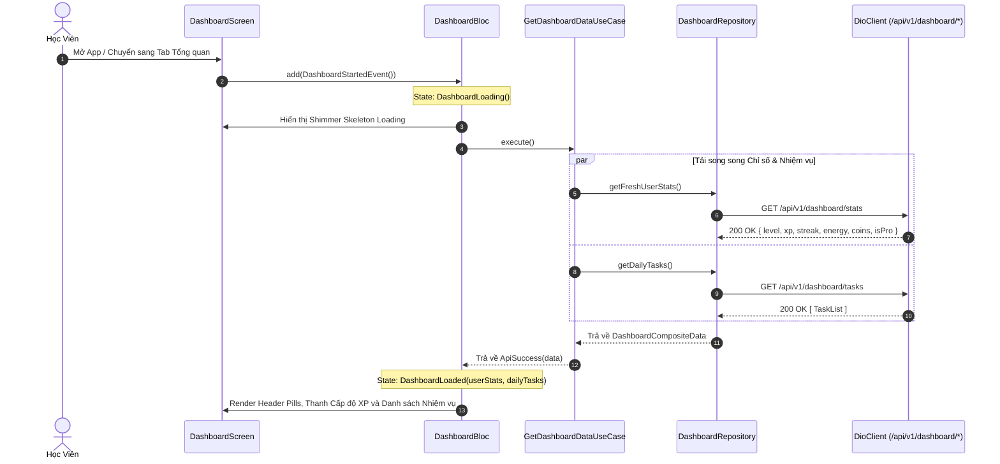
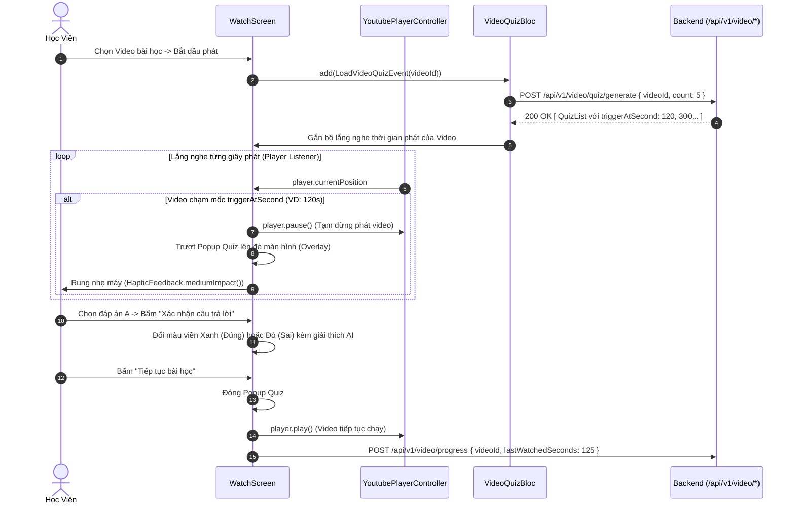
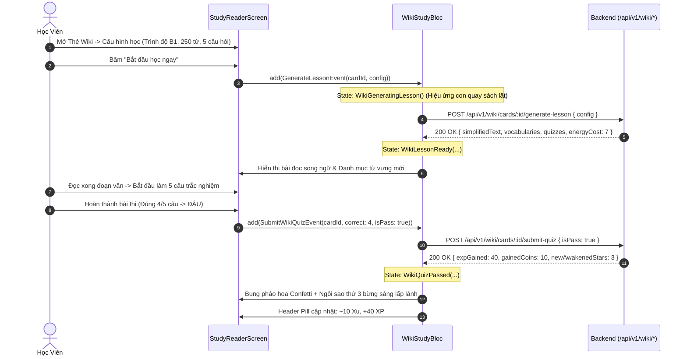
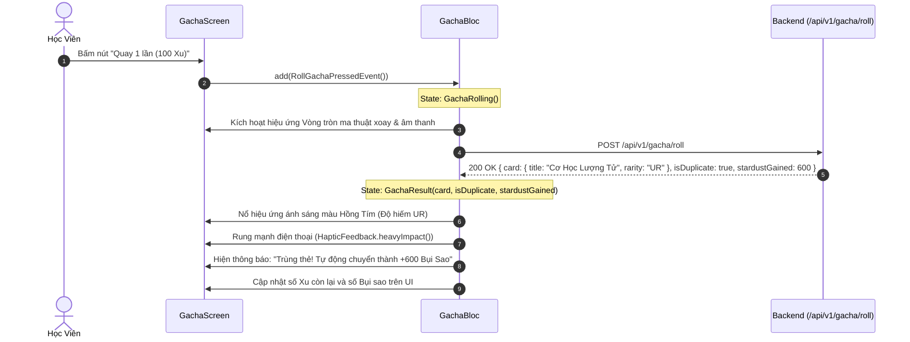
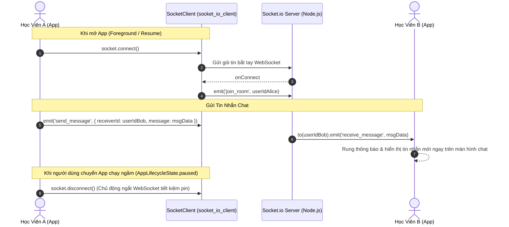
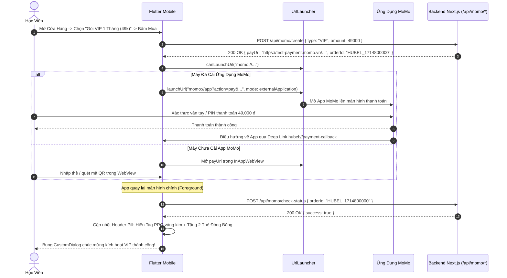

# MOBILE DATA FLOW & LIFECYCLE SPECIFICATION - HUB-EL

> **Tài liệu đặc tả toàn diện Luồng Dữ Liệu (Data Flow) xuyên suốt các tầng kiến trúc trong ứng dụng Flutter Mobile**  
> Định hướng tích hợp mượt mà giữa Presentation Layer, BLoC, Domain, Data và Backend API.

---

## 1. Chu Trình Luân Chuyển Dữ Liệu Chuẩn (Standard Unidirectional Data Flow)

Trong `hub_el_mobile`, dữ liệu luôn luân chuyển theo một chiều duy nhất (Unidirectional Data Flow - UDF):

```
┌─────────────────┐       Tương tác (Tap, Input)       ┌─────────────────┐
│                 ├───────────────────────────────────►│                 │
│  UI Presentation│                                    │  BLoC / Cubit   │
│  (Screen/Widget)│◄───────────────────────────────────┤                 │
└─────────────────┘        State Update (Rebuild)      └────────┬────────┘
                                                                │
                                                  Thực thi      │ Gọi UseCase
                                                                ▼
┌─────────────────┐        ApiResult<Entity>           ┌─────────────────┐
│                 ├───────────────────────────────────►│                 │
│ Repository Impl │                                    │ Domain UseCase  │
│                 │◄───────────────────────────────────┤                 │
└────────┬────────┘        Truy vấn nghiệp vụ          └─────────────────┘
         │
         ├─────────────────────────────────┐
         │ Gọi Remote API                  │ Đọc/Ghi Bộ Nhớ
         ▼                                 ▼
┌─────────────────┐               ┌─────────────────┐
│ Remote DataSrc  │               │ Local DataSrc   │
│ (Dio / Socket)  │               │ (SecureStorage) │
└─────────────────┘               └─────────────────┘
```

---

## 2. Chi Tiết Các Kịch Bản Luồng Dữ Liệu Cốt Lõi (Core Scenario Flows)

### Kịch Bản 1: Tải Trang Chủ Dashboard & Đồng Bộ Nhiệm Vụ Ngày



---

### Kịch Bản 2: Xem Video YouTube & Tạm Dừng Hiện Popup Quiz AI



---

### Kịch Bản 3: Sinh Bài Đọc Wiki AI Thích Ứng & Thức Tỉnh Sao



---

### Kịch Bản 4: Quay Vòng Gacha, Kiểm Tra Pity & Tái Chế Thẻ Trùng



---

### Kịch Bản 5: Nhắn Tin Thời Gian Thực & Vòng Đời Kết Nối Socket.io



---

### Kịch Bản 6: Thanh Toán MoMo In-App Deep Link & Polling



---

## 3. Quản Lý Lỗi & Truyền Dẫn Lỗi (Error Propagation Pipeline)

Khi gặp sự cố mạng hoặc lỗi nghiệp vụ, lỗi được đóng gói và hiển thị theo quy tắc:

```
[Mạng Chập Chờn / Quá Giờ 15s]
        ▼
DioException (connectTimeout)
        ▼
ErrorInterceptor bóc tách thành NetworkException
        ▼
Repository trả về: ApiFailure(message: "Không thể kết nối máy chủ...")
        ▼
Bloc phát State: FeatureFailure(message)
        ▼
UI hiển thị: ErrorStateWidget (màn hình đầy đủ) HOẶC Toastification / SnackBar (hành động nhanh)
```

