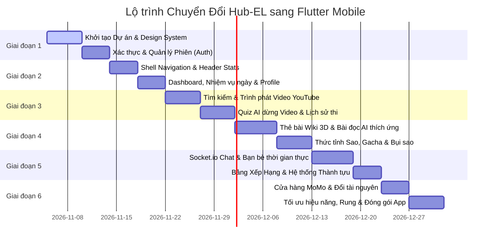

# MOBILE MIGRATION PLAN - HUB-EL FLUTTER APP

> **Kế hoạch hành động và Lộ trình chuyển đổi (Roadmap) ứng dụng Web Hub-EL sang Flutter Mobile**  
> Dự án đích: `hub_el_mobile`

---

## 1. Kiến Trúc Ứng Dụng Flutter Đề Xuất (Architecture Blueprint)

Để đảm bảo hiệu năng cao, dễ bảo trì và mở rộng lâu dài trên cả Android và iOS, `hub_el_mobile` sẽ được xây dựng theo mô hình **Feature-First Clean Architecture**:

```
hub_el_mobile/lib/
├── app/
│   ├── app.dart                     # MaterialApp, Theme, Route configuration
│   ├── observer.dart                # BlocObserver / RouteObserver
│   └── routes.dart                  # GoRouter hoặc Navigator 2.0
├── core/
│   ├── constants/                   # Colors, Typography, Durations, API Endpoints
│   ├── network/                     # Dio Client, Interceptors, WebSocket Client
│   ├── storage/                     # SecureStorage, SharedPreferences
│   ├── theme/                       # Light & Dark ThemeData, ColorScheme
│   └── utils/                       # Formatters, Leveling Calculators, Validators
└── features/                        # Phân chia theo từng phân hệ nghiệp vụ độc lập
    ├── auth/                        # Presentation (Screens, Blocs), Domain, Data
    ├── dashboard/                   # Home, Quests, Header Stats
    ├── video_learning/              # Explore, YouTube Player, AI Quiz Overlay
    ├── wiki_learning/               # Wiki Cards, Study Reader, Star Awakening
    ├── gacha/                       # Vòng quay Gacha, Pity Counter, Shop Bụi Sao
    ├── vocabulary/                  # Sổ tay từ vựng, TTS phát âm
    ├── social/                      # Chat 1-1, Chat Nhóm, Bạn bè, Socket Handler
    ├── leaderboard/                 # Podium, Bảng xếp hạng 4 hạng mục
    ├── achievements/                # Bộ sưu tập danh hiệu, Easter Eggs, Toast
    ├── store/                       # Mua gói VIP, nạp Ngọc qua MoMo, đổi tài nguyên
    └── profile/                     # Thông tin cá nhân, Cài đặt bảo mật & thông báo
```

### Mỗi Thư Mục Feature Chứa 3 Lớp Chuẩn:
1. **`presentation/`**: Chứa UI Widgets, Screens và State Controllers (Cubit / BLoC).
2. **`domain/`**: Chứa Business Entities và Use Cases (quy tắc nghiệp vụ độc lập không phụ thuộc UI hay API).
3. **`data/`**: Chứa Models (JSON Serialization), Data Sources (Remote API, Local DB) và Repositories Implementation.

---

## 2. Chiến Lược Kỹ Thuật Cho Các Thách Thức Cốt Lõi (Key Technical Strategies)

### A. Chiến Lược Gọi Backend (Server Actions vs REST API)
- **Thách thức:** Web `hub-el` dùng Next.js Server Actions (`"use server"`), không phải REST API thông thường.
- **Giải pháp:**
  - **Phương án 1 (Khuyên dùng):** Tạo thêm một thư mục REST API trung gian trên backend `hub-el/src/app/api/v1/...` gọi trực tiếp vào các hàm Server Actions sẵn có. Toàn bộ logic nghiệp vụ trong database không bị xáo trộn.
  - **Phương án 2:** Thiết lập phiên đăng nhập JWT, gửi HTTP POST với payload JSON tới các Route Handlers được tạo sẵn.

### B. Tích Hợp Thanh Toán MoMo Trên Mobile
- Khi người dùng bấm Mua VIP / Nạp Ngọc:
  1. App gọi API `POST /api/momo/create` nhận về `payUrl`.
  2. Dùng thư viện `url_launcher` để kiểm tra: Nếu máy đã cài App MoMo $\rightarrow$ Bật Deep Link `momo://...` để mở thẳng App MoMo thanh toán 1 chạm.
  3. Nếu máy chưa cài App MoMo $\rightarrow$ Mở `payUrl` trong `InAppWebView`.
  4. Sau khi thanh toán, MoMo điều hướng về Deep Link của App `hubel://payment-result?orderId=...`.
  5. App Flutter gọi `POST /api/momo/check-status` để kích hoạt tài nguyên và hiển thị thông báo thành công.

### C. Quản Lý Vòng Đời Kết Nối Realtime (Socket.io Lifecycle)
- Khi App chuyển xuống chạy ngầm (Background / Screen lock) $\rightarrow$ Tự động ngắt kết nối WebSocket để tiết kiệm pin.
- Khi App mở lại (Foreground / Resume) $\rightarrow$ Tự động kết nối lại, phát sự kiện `join_room(userId)` và truy vấn lịch sử tin nhắn mới nhất.

---

## 3. Lộ Trình Triển Khai Chi Tiết (6-Phase Implementation Roadmap)



---

### Chi Tiết Từng Giai Đoạn (Detailed Phase Deliverables)

#### Giai đoạn 1: Nền tảng, Hệ thống Thiết kế & Xác thực (Foundation & Auth)
- Cấu hình toàn bộ mã màu Hex, Dark/Light Theme, Type scale theo chuẩn [`DESIGN_SYSTEM.md`](file:///d:/Coder/hub_el_mobile/docs/DESIGN_SYSTEM.md).
- Cài đặt `dio`, `flutter_secure_storage`, `flutter_bloc`.
- Xây dựng màn hình Đăng nhập (`LoginScreen`), Đăng ký (`RegisterScreen`), Quên mật khẩu & OTP Email (`ForgotPasswordScreen`).
- Lưu trữ Session Token bảo mật.

#### Giai đoạn 2: Khung Điều Hướng, Dashboard & Nhiệm vụ Ngày (Shell & Dashboard)
- Xây dựng thanh điều hướng `MobileNav` nhô cao ở giữa với nút "Khóa học".
- Xây dựng thanh `Header` chứa hàng viên thuốc chỉ số tài nguyên (Streak, Năng lượng, Xu, Ngọc).
- Màn hình `Dashboard`: Khối chào hỏi, tiến độ cấp độ/XP, danh sách nhiệm vụ ngày (`DailyTaskProgress`), nút nhận thưởng Xu/XP.
- Màn hình `Profile` và `Settings` (đổi tên, avatar, mật khẩu, quyền riêng tư).

#### Giai đoạn 3: Học Tập Qua Video YouTube & Trắc Nghiệm AI (Video & Quiz Engine)
- Màn hình `ExploreScreen`: Tìm kiếm video giáo dục, áp dụng bộ lọc Blacklist/Whitelist.
- Màn hình `WatchScreen`: Tích hợp `youtube_player_flutter`, hỗ trợ xoay ngang toàn màn hình.
- Logic đồng bộ tiến độ xem (`lastWatched`).
- Popup trắc nghiệm AI dừng video khi chạm mốc thời gian, tính điểm và lưu kết quả vào `quiz_attempts`.

#### Giai đoạn 4: Ngoại Ngữ với Wiki, Gacha & Sổ Tay Từ Vựng (Wiki & Gamification)
- Màn hình `WikiManagerScreen`: Lưới thẻ bài phân loại theo độ hiếm N $\rightarrow$ MR.
- Widget `WikiCard3D`: Hiệu ứng lật thẻ 180 độ xem nội dung tóm tắt và từ vựng.
- Màn hình `StudyReaderScreen`: Cấu hình học tập (A1-C2, số từ), sinh bài đọc AI và 5 dạng câu hỏi trắc nghiệm.
- Logic Thức tỉnh Sao (+1 sao khi đậu, -1 sao khi trượt, tiêu 50 Xu để giữ sao).
- Màn hình `GachaScreen`: Vòng quay Gacha ngẫu nhiên, cơ chế bảo hiểm Pity (10/50/120), đổi Bụi Sao trong Shop.
- Màn hình `VocabularyScreen`: Sổ tay từ vựng cá nhân, tích hợp phát âm tiếng Anh qua loa (`flutter_tts`).

#### Giai đoạn 5: Mạng Xã Hội Thời Gian Thực & Vinh Danh (Social & Community)
- Tích hợp `socket_io_client`: Đăng ký phòng `join_room`, lắng nghe và gửi tin nhắn thời gian thực.
- Màn hình `SocialScreen`: Quản lý danh sách bạn bè, gửi lời mời, chấp nhận/từ chối kết bạn.
- Màn hình `ChatScreen`: Nhắn tin 1-1, chat nhóm, đính kèm ảnh, gửi tặng Hộp Quà Thẻ SSR.
- Màn hình `LeaderboardScreen`: Bục vinh danh Top 3, danh sách xếp hạng 4 tiêu chí (Streak, XP, Thời gian, AI Quiz).
- Màn hình `AchievementsScreen`: Bộ sưu tập huy hiệu 6 Tier và các danh hiệu ẩn Easter Eggs.

#### Giai đoạn 6: Cửa Hàng MoMo, Tối Ưu Hóa & Hoàn Thiện (Monetization & Polish)
- Màn hình `StoreScreen`: Đổi tài nguyên (Ngọc <-> Xu <-> Năng lượng).
- Tích hợp thanh toán MoMo: Tạo đơn hàng, mở App MoMo hoặc WebView, lắng nghe kết quả thanh toán.
- Bổ sung hiệu ứng rung haptic (`HapticFeedback`), pháo hoa `confetti` khi lên cấp/mở khóa thành tựu.
- Kiểm thử kiểm duyệt nội dung, kiểm tra rò rỉ bộ nhớ (memory leaks), tối ưu kích thước file APK / IPA.

