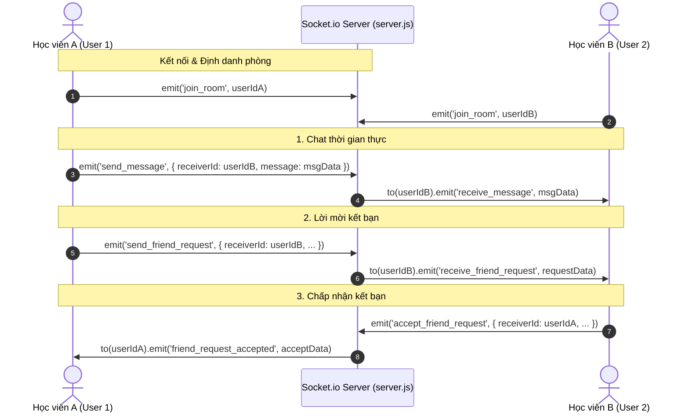

# WEB ARCHITECTURE ANALYSIS - HUB-EL

> **Tài liệu tham chiếu kiến trúc hệ thống hiện tại của ứng dụng Web `hub-el`**  
> Dành cho quá trình chuyển đổi (migration) sang Flutter Mobile App `hub_el_mobile`.

---

## 1. Tổng quan Công nghệ (Technology Stack)

Căn cứ từ [`hub-el/package.json`](file:///d:/Coder/Web/hub-el/package.json) và [`hub-el/server.js`](file:///d:/Coder/Web/hub-el/server.js):

| Hạng mục | Công nghệ sử dụng | Phiên bản | Vai trò & Mục đích |
| :--- | :--- | :--- | :--- |
| **Framework Web** | Next.js (App Router) | `16.2.3` | Server-Side Rendering (SSR), Server Components, Server Actions, Route Handlers |
| **UI Library** | React | `19.2.4` | Xây dựng giao diện người dùng tương tác |
| **Styling & Theme** | Tailwind CSS + tw-animate-css + next-themes | `v4.0` | Utility-first CSS, dark/light mode switching, animate utilities |
| **Component Kit** | Shadcn UI + Radix UI + Lucide React | `shadcn 4.2.0`, `radix-ui 1.4.3` | Hệ thống component nguyên tử (Atoms/Molecules), icon đồng nhất |
| **Database ORM** | Prisma Client | `6.19.3` | Tương tác CSDL SQL Server, quản lý migration và schema quan hệ |
| **Database Engine** | Microsoft SQL Server | - | Lưu trữ quan hệ (Users, Inventory, Quizzes, Chats, Orders, DailyStats) |
| **Authentication** | NextAuth.js (Auth.js) | `5.0.0-beta.30` | Quản lý phiên JWT, OAuth (Google, GitHub), Credentials (Bcrypt.js) |
| **Realtime Engine** | Socket.io + Socket.io-client | `4.8.3` | Tích hợp trong `server.js` cho chat 1-1, chat nhóm, thông báo lời mời kết bạn |
| **State & Cache** | TanStack React Query | `5.99.0` | Client-side cache, synchronization |
| **AI Integration** | Google Generative AI (`@google/generative-ai`) | `0.24.1` | Tự động tạo bài tập, tóm tắt và trích xuất từ vựng từ video/Wikipedia |
| **Video & Subtitles**| `youtube-transcript`, YouTube Data API v3 | `1.3.1` | Trích xuất phụ đề video, tìm kiếm và phân tích video giáo dục |
| **Payment Gateway** | MoMo Payment API (v2 Gateway) | - | Thanh toán nạp Ngọc (Coins) và mua gói VIP (Pro) qua MoMo |
| **Email Service** | Nodemailer | `7.0.13` | Gửi email thông báo kết bạn, mã OTP xác thực quên mật khẩu |
| **Charts & Effects** | Recharts, React Confetti, Avatar Editor | `3.8.1`, `6.4.0` | Biểu đồ học tập, hiệu ứng chúc mừng lên cấp/thành tựu, cắt ảnh avatar |

---

## 2. Cấu trúc Thư mục và Trách nhiệm (Folder Structure & Responsibilities)

Căn cứ từ mã nguồn thực tế tại [`hub-el/src`](file:///d:/Coder/Web/hub-el/src):

```
hub-el/
├── server.js                        # Node.js custom server kết hợp Next.js & Socket.io
├── prisma/
│   └── schema.prisma                # Cấu trúc CSDL toàn hệ thống với 26 Models
└── src/
    ├── actions/                     # Next.js Server Actions (Business Logic tầng Server)
    │   ├── achievements.ts          # Logic kiểm tra & mở khóa thành tựu
    │   ├── gacha.ts                 # Quay thẻ Wiki, bảo hiểm Pity, đổi Bụi sao (Stardust)
    │   ├── leaderboard.ts           # Xếp hạng (Streak, Grinder XP, Thời gian, AI Quiz)
    │   ├── quiz.ts                  # Tạo bài đọc AI từ Wiki, tính điểm & cập nhật sao thẻ
    │   ├── stats.ts                 # Thống kê tổng hợp học tập của học viên
    │   ├── store.ts                 # Đổi tài nguyên (Ngọc <-> Xu <-> Năng lượng)
    │   ├── vocabulary.ts            # Quản lý sổ tay từ vựng
    │   ├── wiki-manager.ts          # Quản trị bài viết & thẻ Wiki
    │   ├── wiki.ts                  # Chi tiết thẻ Wiki, danh sách thẻ cá nhân
    │   ├── admin/                   # Server Actions dành cho Admin (Keywords, Moderation, User...)
    │   ├── auth/                    # Server Actions xác thực (Đăng ký, Quên mật khẩu, OTP)
    │   ├── quests/                  # Quản lý & cộng dồn tiến độ nhiệm vụ hằng ngày
    │   ├── quiz/                    # Tạo Quiz từ Video YouTube qua Gemini AI
    │   ├── social/                  # Kết bạn, tin nhắn 1-1, chat nhóm, tặng thẻ bài
    │   ├── user/                    # Settings (Hồ sơ, Quyền riêng tư, Thông báo, Bảo mật)
    │   └── video/                   # Tìm kiếm nâng cao, Lọc nội dung giáo dục, Video yêu thích
    ├── app/                         # App Router Pages & API Routes
    │   ├── (auth)/                  # Nhóm route xác thực: /login, /register
    │   ├── (main)/                  # Nhóm route giao diện học viên có Sidebar/Header/MobileNav
    │   │   ├── dashboard/           # Trang chủ học tập, nhiệm vụ ngày, streak, năng lượng
    │   │   ├── courses/             # Video & danh sách phát đã lưu/yêu thích
    │   │   ├── quizzes/             # Góc luyện tập trắc nghiệm & ôn tập lịch sử làm bài
    │   │   ├── explore/             # Tìm kiếm video giáo dục nâng cao
    │   │   ├── watch/[videoId]/     # Trình phát video YouTube có dừng popup Quiz AI
    │   │   ├── wiki-manager/        # Thư viện Thẻ học Ngoại ngữ Wiki
    │   │   ├── wiki/[id]/           # Chi tiết bài đọc AI & làm trắc nghiệm tăng sao
    │   │   ├── gacha/               # Vòng quay Gacha thẻ Wiki & Shop Bụi Sao
    │   │   ├── vocabulary/          # Sổ tay từ vựng cá nhân
    │   │   ├── social/              # Trung tâm kết bạn & phòng chat thời gian thực
    │   │   ├── leaderboard/         # Bảng vinh danh học viên
    │   │   ├── achievements/        # Bộ sưu tập danh hiệu & Easter Eggs
    │   │   ├── store/               # Cửa hàng nạp Ngọc, nâng cấp VIP, đổi tài nguyên
    │   │   ├── profile/[id]/        # Trang cá nhân của người dùng
    │   │   └── settings/            # Cài đặt tài khoản, ngôn ngữ mục tiêu & thông báo
    │   ├── admin/                   # Cổng quản trị: duyệt video, từ khóa, kiểm duyệt, đơn hàng
    │   └── api/                     # REST Route Handlers
    │       ├── auth/[...nextauth]/  # Endpoint xác thực NextAuth
    │       ├── momo/                # Tạo link thanh toán, callback IPN, check-status
    │       ├── cron/                # Tác vụ định kỳ (nhắc nhở học tập, cào bài Wiki)
    │       └── upload/message/      # Upload ảnh & file đính kèm trong chat
    ├── components/                  # UI Components phân lớp
    │   ├── features/                # Components đặc thù: Gacha, Social, Dashboard, Achievements
    │   ├── layout/                  # Header, Sidebar, MobileNav, ThemeToggle, FeedbackButton
    │   ├── modals/                  # StatsModal, ShareVideoModal, ExchangeModal
    │   ├── shared/                  # Thẻ thống kê, user dropdown
    │   └── ui/                      # Button, Card, WikiCard3D...
    ├── config/                      # Danh sách cấu hình (Hệ thống thành tựu & mốc thưởng)
    ├── lib/                         # Tiện ích dùng chung
    │   ├── auth.ts                  # Cấu hình NextAuth Providers & Callbacks
    │   ├── leveling.ts              # Thuật toán tính Cấp, XP và giới hạn Năng lượng (Cap)
    │   ├── prisma.ts                # Khởi tạo Prisma Client Singleton
    │   ├── quiz/gemini.ts           # Giao tiếp với Google Gemini API
    │   └── video/youtube.ts         # YouTube API wrapper, thuật toán kiểm duyệt nội dung
    └── providers/                   # Context Providers (QueryProvider, ThemeProvider)
```

---

## 3. Kiến trúc Luồng Dữ liệu & Giao thức Giao tiếp

### A. Next.js Server Actions vs REST Route Handlers
Hệ thống Web `hub-el` chia luồng xử lý backend làm 2 dạng:
1. **Server Actions (`"use server"`):** Chiếm ~90% business logic (Gacha, Quiz, Quest, Social, Video, Profile...). Ưu điểm là gọi trực tiếp từ React component mà không cần cấu hình thủ công endpoint REST, trả về đối tượng kết quả chuẩn `{ success: boolean, data?: any, message?: string }`.
2. **REST API Route Handlers (`src/app/api`):** Được sử dụng cho các tác vụ webhook/callback hoặc bên thứ 3:
   - NextAuth OAuth Handlers (`/api/auth/[...nextauth]`)
   - MoMo Payment IPN Callback & Status Check (`/api/momo/*`)
   - Cron Jobs định kỳ (`/api/cron/*`)
   - Upload file Multipart (`/api/upload/message`)

> [!IMPORTANT]
> **Định hướng Mobile (Flutter):**
> Khi chuyển đổi sang Flutter, do Flutter không thể gọi trực tiếp Next.js Server Actions theo cơ chế RPC của trình duyệt, backend cần được phơi bày (expose) thông qua các RESTful API endpoints chuẩn hoặc thông qua một tầng API Gateway trung gian phản chiếu các Server Actions này.

---

### B. Kiến trúc Realtime Socket.io

Căn cứ [`hub-el/server.js`](file:///d:/Coder/Web/hub-el/server.js):
- Máy chủ HTTP Node.js bọc ứng dụng Next.js và gắn kết instance Socket.io trên cùng một cổng (`port 3000`).
- **Danh sách Event cốt lõi:**



---

### C. Quản lý Trạng thái & Cơ chế Bus Sự kiện Toàn cục (Event Bus)

Căn cứ [`src/components/layout/header.tsx`](file:///d:/Coder/Web/hub-el/src/components/layout/header.tsx) và [`src/components/layout/sidebar.tsx`](file:///d:/Coder/Web/hub-el/src/components/layout/sidebar.tsx):
Web client sử dụng `window.addEventListener` làm Custom Event Bus để đồng bộ chỉ số thời gian thực giữa các component mà không gây render lại toàn trang:
1. `updateUserStats`: Truyền tải `{ xpDelta, coinsDelta, energyCost, energyDelta, premiumCoinsDelta, isPro }` để Header/Sidebar cập nhật thanh XP, cấp độ, số xu, năng lượng ngay lập tức.
2. `updateUserProfile`: Cập nhật thông tin avatar, tên hiển thị khi user thay đổi cài đặt.
3. `quizCompleted`: Kích hoạt animation giật chuỗi Streak (Streak Bumping) và cập nhật số ngày học.

---

## 4. Bảo mật & Xác thực (Security & Authentication)

Căn cứ [`src/lib/auth.ts`](file:///d:/Coder/Web/hub-el/src/lib/auth.ts):
- **Cơ chế:** NextAuth v5 cấu hình `session: { strategy: "jwt" }`.
- **Nhà cung cấp (Providers):**
  - **Credentials Provider:** So khớp email & mật khẩu mã hóa bằng `bcryptjs.compare`.
  - **Google OAuth Provider:** Tự động lấy avatar và họ tên.
  - **GitHub OAuth Provider:** Tích hợp xác thực GitHub.
- **Chốt chặn phân quyền (Access Control):**
  - Kiểm tra tài khoản bị cấm (`user.role === "banned"` / `"BANNED"`) ngay tại bước `authorize` và callback `signIn`.
  - Đóng gói thông tin đặc quyền vào JWT token: `freeCoins`, `aiTokens`, `currentStreak`, `level`, `xp`, `streakFreezes`, `isPro`, `role`.
- **Xác thực OTP:** Bảng `verification_codes` quản lý mã OTP 6 số để kích hoạt cấp lại mật khẩu qua email.

---

## 5. Kết luận cho Kiến trúc Mobile

Khi chuyển đổi sang Flutter `hub_el_mobile`:
1. **Networking:** Sử dụng thư viện `dio` với cấu hình Interceptor để lưu trữ Access Token / Session Cookie, tự động xử lý refresh token và bắt lỗi 401/403.
2. **Socket Client:** Sử dụng `socket_io_client` kết nối tới Socket.io server, giữ nguyên các payload sự kiện `join_room`, `send_message`, `receive_message`.
3. **State Management:** Thay thế Event Bus và React Context bằng **Bloc / Cubit** hoặc **Riverpod** nhằm quản lý trạng thái tập trung cho UserStats, AuthState, ChatState.
4. **Local Persistence:** Sử dụng `flutter_secure_storage` lưu token bảo mật và `shared_preferences` lưu cấu hình giao diện (ThemeMode, ngôn ngữ).

