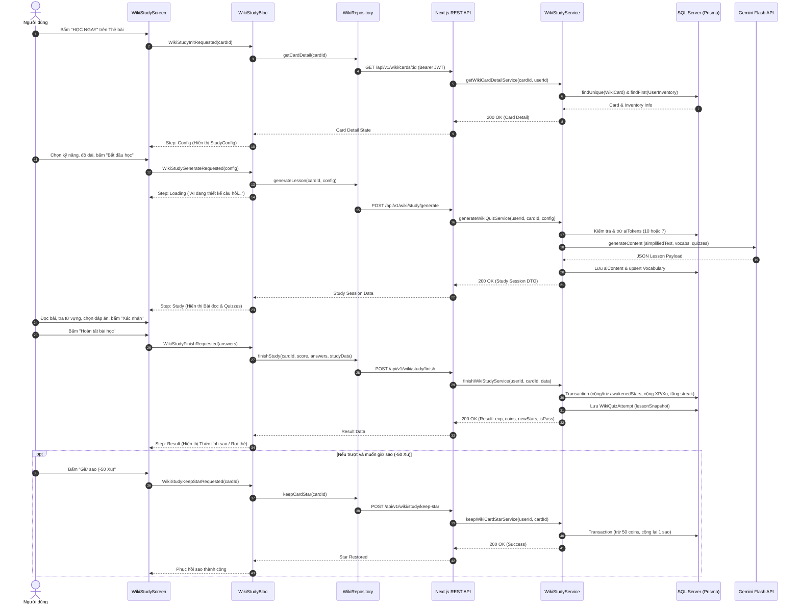

# KẾ HOẠCH TRIỂN KHAI MODULE WIKI STUDY & STAR AWAKENING (GIAI ĐOẠN 4 – BƯỚC 5B)

## 1. TỔNG QUAN

Tài liệu này xác định kiến trúc, kế hoạch chi tiết và bản đồ chuyển đổi 1:1 từ Mobile Web (`hub-el`) sang Flutter Native (`hub_el_mobile`) cho module **Wiki Study & Star Awakening (Học bài theo thẻ và thức tỉnh sao)**.

Tuân thủ nghiêm ngặt nguyên tắc: **Không tự thiết kế lại giao diện, không sử dụng WebView, tái sử dụng 100% dữ liệu nghiệp vụ và design tokens từ Mobile Web.**

---

## 2. SOURCE CODE MOBILE WEB THAM CHIẾU (`hub-el`)

| Mobile Web Component / File | Đường dẫn | Chức năng chính |
|---|---|---|
| `WikiReaderStudyView` | `src/app/(main)/wiki/[id]/page.tsx` | Màn hình chính điều phối 4 bước: `config` -> `loading` -> `study` -> `result`. Quản lý âm thanh đọc câu, bộ đếm thời gian, danh sách từ vựng, tính điểm, gọi API kết thúc bài học, hiệu ứng rơi thẻ/mất sao/giữ sao. |
| `StudyConfig` | `src/app/(main)/wiki/[id]/_components/StudyConfig.tsx` | Giao diện cấu hình bài học: Ngôn ngữ mục tiêu, trình độ (A1-C2), số câu hỏi, thời gian làm bài, thanh trượt kép độ dài bài đọc (100-700 từ), chọn kỹ năng câu hỏi, hiển thị mức tiêu hao Năng lượng AI (10 NL hoặc 7 NL với PRO). |
| `VocabSidebar` | `src/app/(main)/wiki/[id]/page.tsx` (L80-L130) | Bảng trượt danh sách từ vựng khó: Phát âm (Phonetic & Audio), từ loại (POS), nghĩa tiếng Việt, câu giải thích mẫu. |
| `SceneBackground` | `src/app/(main)/wiki/[id]/page.tsx` (L53-L78) | Nền động với bầu trời sao (Dark mode) / mây trôi (Light mode) và dãy núi vector phong cảnh. |
| `WikiCard3D` | `src/components/ui/wiki-card-3d.tsx` | Thẻ bài 3D hiển thị hiệu ứng thức tỉnh sao thành công (`cardRevealScale`), hiệu ứng rơi rụng khi trượt (`cardDropOut`), dàn sao thức tỉnh. |
| Server Actions | `src/actions/quiz.ts` | `generateQuizFromWikiCard`, `addExpToUser`, `keepCardStar`, `saveWikiQuizHistory`. |
| Server Action | `src/actions/wiki.ts` | `getWikiCardDetail(cardId)`. |

---

## 3. PRISMA MODELS & HỆ THỐNG CƠ SỞ DỮ LIỆU (SQL SERVER)

Tái sử dụng các models hiện có trong Prisma ORM (`prisma/schema.prisma`):

1. **`WikiCard`**:
   - `id`: Int (Khóa chính)
   - `title`: String (Tiêu đề thẻ)
   - `rarity`: String (`N`, `R`, `SR`, `SSR`, `UR`, `LR`, `MR`)
   - `imageUrl`: String? (Hình ảnh đại diện)
   - `aiContent`: String? (JSON snapshot lưu trữ nội dung bài đọc và câu hỏi gần nhất)
   - `totalStars`: Int (Tổng số sao thức tỉnh tối đa của thẻ: 1 đến 7 sao tùy độ hiếm)
   - `awakenedStars`: Int (Số sao đã thức tỉnh toàn cục / mặc định của thẻ)
   - `contentText`: String? (Nội dung văn bản gốc cào từ Wikipedia)
   - `chunkData`: String? (JSON mảng các đoạn văn bản <= 2000 ký tự phục vụ đưa vào Gemini AI)

2. **`UserInventory`**:
   - `id`: Int
   - `userId`: String
   - `cardId`: Int
   - `acquiredAt`: DateTime
   - `currentStar`: Int (Số sao thức tỉnh riêng của người dùng cho thẻ này)
   - `isCompleted`: Boolean (Đã hoàn tất thức tỉnh max sao hay chưa)

3. **`User`**:
   - `id`: String
   - `aiTokens`: Int (Năng lượng AI hiện có - tiêu hao 10 NL hoặc 7 NL nếu là Pro)
   - `freeCoins`: Int (Số xu hiện có - dùng 50 xu để giữ sao khi làm bài trượt)
   - `level`: Int & `exp`: Int (Cấp độ và kinh nghiệm người dùng)
   - `currentStreak`: Int & `highestStreak`: Int & `lastStudyDate`: DateTime (Chuỗi ngày học liên tục)
   - `isPro`: Boolean

4. **`WikiQuizAttempt`**:
   - `id`: Int
   - `userId`: String
   - `cardId`: Int
   - `score`: Float & `correctCount`: Int & `totalQuizzes`: Int
   - `userAnswers`: String (JSON mảng các đáp án đã chọn)
   - `lessonSnapshot`: String (JSON snapshot toàn bộ bài đọc, từ vựng, câu hỏi & đáp án)

5. **`Vocabulary`**:
   - `id`: Int
   - `cardId`: Int
   - `word`: String
   - `pos`: String (N, V, ADJ, ADV, ...)
   - `meaning`: String
   - `englishDesc`: String (Phiên âm + cách đọc + ngữ cảnh)
   - `language`: String

6. **`UserStats` & `DailyStat`**:
   - Cập nhật số năng lượng AI đã dùng (`totalAiEnergySpent`), số từ mới học (`learnedWordsCount`), số xu tiêu (`totalCoinsSpent`), XP nhận trong ngày (`xpGained`).

---

## 4. BẢN ĐỒ CHUYỂN ĐỔI REACT COMPONENTS SANG FLUTTER WIDGETS

| Mobile Web Component (`hub-el`) | Flutter Native Widget (`hub_el_mobile`) | Ghi chú chuyển đổi |
|---|---|---|
| `WikiReaderStudyView` (`wiki/[id]/page.tsx`) | `WikiStudyScreen` (`lib/features/wiki/presentation/screens/wiki_study_screen.dart`) | State machine điều phối 4 bước: `StudyConfigStep`, `StudyLoadingStep`, `StudyReadingQuizStep`, `StudyResultStep`. |
| `StudyConfig` | `WikiStudyConfigWidget` (`lib/features/wiki/presentation/widgets/wiki_study_config_widget.dart`) | Cấu hình ngôn ngữ, trình độ, thanh trượt số câu (2..15), thanh trượt thời gian (0..60), thanh trượt kép số từ (100..700 từ), chọn kỹ năng (checkbox cards), nút CTA tiêu hao năng lượng. |
| Dropdown ngôn ngữ & trình độ | `WikiDropdownWidget` | Custom bottom sheet / popup selector bo góc chuẩn 12px với icon cờ & level badges. |
| Thanh trượt kép độ dài bài đọc | `WikiDualRangeSlider` | Custom Flutter `RangeSlider` với gradient teal `[0xFF14B8A6]` và nhãn số từ nổi bật. |
| Kỹ năng câu hỏi (`QUIZ_SKILLS`) | `WikiSkillSelector` | Lưới các button chọn nhiều kỹ năng với checkbox tick xanh dương khi chọn. |
| Loading view (`step === 'loading'`) | `WikiStudyLoadingWidget` | Spinner tròn màu xanh với thông điệp: "AI đang thiết kế X câu hỏi...". |
| Thanh điều hướng trên (`study` step) | `WikiStudyTopBar` | Nút "Kho thẻ" (Back), pill ngôn ngữ + level, đồng hồ đếm ngược (đổi màu đỏ & nhấp nháy khi <= 60s), nút mở Từ Vựng. |
| Khối đọc bài (`simplifiedText`) | `WikiReadingPassageWidget` | Text với từng câu có thể chạm để đọc phát âm (Text-to-Speech), highlight màu xanh dương khi đang phát, từ vựng khó in đậm màu xanh dương kèm tooltip, từ khóa đoán nghĩa highlight vàng. |
| `VocabSidebar` | `WikiVocabularySheet` | DraggableScrollableSheet / Side panel hiển thị danh sách từ vựng, nút loa phát âm, phonetic, từ loại, nghĩa tiếng Việt và ví dụ. |
| Khối kiểm tra (`studyData.quizzes`) | `WikiQuizSectionWidget` | Danh sách các card câu hỏi: Số thứ tự Q1, Q2, badge loại câu (Trắc nghiệm, Đúng/Sai, Ý chính, Suy luận, Đoán nghĩa), text câu hỏi, các nút phương án trắc nghiệm, nút "Xác nhận", khối giải thích chi tiết sau khi xác nhận. |
| Nút nộp bài | Gradient ElevatedButton | "Hoàn tất bài học" (khi tất cả câu đã được xác nhận) / "Trả lời hết để nộp bài" (khi chưa làm hết). |
| `step === 'result'` (Đậu) | `WikiStudySuccessView` | Hiệu ứng pháo hoa Confetti, hiển thị thẻ 3D thức tỉnh sao, badge XP, Xu và Sao nhận được, nút "Xác nhận". |
| `step === 'result'` (Trượt) | `WikiStudyFailView` | Thẻ bài rơi rụng (`cardDropOut`), thông báo mất 1 sao (nếu đã có sao), nút cứu sao "Giữ sao (-50 Xu)" gọi `keepCardStar`, nút "Thử lại sau". |

---

## 5. THIẾT KẾ REST API BRIDGE & WIKI STUDY SERVICE

Để đảm bảo nguyên tắc kiến trúc Mục 12 (Tách service dùng chung, bảo mật JWT, không sao chép logic):

### A. Service chung tại `hub-el`: `src/services/wiki-study.service.ts`
1. `getWikiCardDetailService(cardId: number, userId: string)`:
   - Truy vấn thông tin thẻ `WikiCard` và trạng thái sở hữu `UserInventory` của user.
   - Trả về chi tiết thẻ, số sao hiện tại của user, số sao tối đa.
2. `generateWikiQuizService(userId: string, cardId: number, config: QuizConfigDTO)`:
   - Xác thực năng lượng AI (`aiTokens >= aiCost`).
   - Cắt chuỗi / xáo trộn chunk Wikipedia và gọi Gemini API sinh nội dung (bài đọc, từ vựng, câu hỏi).
   - Transaction: Cập nhật `aiContent`, trừ `aiTokens`, ghi nhận `userStats`.
3. `finishWikiStudyService(userId: string, cardId: number, payload: FinishStudyDTO)`:
   - Tính toán điểm số, kiểm tra đậu (`score >= ceil(quizzes.length / 2)`).
   - Gọi logic cộng điểm, thức tỉnh sao (+1 sao nếu đậu và chưa max sao, -1 sao nếu trượt và đã có sao).
   - Cập nhật XP, Level, Coins, Streak người dùng.
   - Lưu `WikiQuizAttempt` với snapshot đầy đủ.
4. `keepWikiCardStarService(userId: string, cardId: number)`:
   - Kiểm tra `freeCoins >= 50`.
   - Transaction trừ 50 xu, cộng lại 1 sao thức tỉnh, cập nhật `userStats`.

### B. REST API Endpoints tại `hub-el`
- `GET /api/v1/wiki/cards/:id`: Trả về chi tiết thẻ và trạng thái người dùng.
- `POST /api/v1/wiki/study/generate`: Tạo bài học & câu hỏi AI.
- `POST /api/v1/wiki/study/finish`: Nộp bài, cập nhật sao, thưởng XP/xu và lưu lịch sử.
- `POST /api/v1/wiki/study/keep-star`: Cứu sao với 50 xu.

Tất cả các route trên đều yêu cầu Header: `Authorization: Bearer <JWT_TOKEN>`.

---

## 6. DANH SÁCH FILE DỰ KIẾN TẠO VÀ CHỈNH SỬA

### A. Backend (`hub-el`)
- `src/services/wiki-study.service.ts` *(Mới - Service dùng chung cho Study, Quiz, Star Awakening)*
- `src/app/api/v1/wiki/cards/[id]/route.ts` *(Mới - Chi tiết thẻ)*
- `src/app/api/v1/wiki/study/generate/route.ts` *(Mới - Tạo bài học AI)*
- `src/app/api/v1/wiki/study/finish/route.ts` *(Mới - Hoàn tất bài học, thức tỉnh sao)*
- `src/app/api/v1/wiki/study/keep-star/route.ts` *(Mới - Giữ sao với 50 xu)*

### B. Flutter Mobile (`hub_el_mobile`)
- **Domain Layer:**
  - `lib/features/wiki/domain/entities/wiki_study_session_entity.dart` *(Mới - Session bài học, simplifiedText, vocabularies, quizzes)*
  - `lib/features/wiki/domain/entities/wiki_study_result_entity.dart` *(Mới - Kết quả bài học: exp, coins, awakenedStars, isPass, lostStar)*
  - `lib/features/wiki/domain/usecases/get_wiki_card_detail_usecase.dart` *(Mới)*
  - `lib/features/wiki/domain/usecases/generate_wiki_study_usecase.dart` *(Mới)*
  - `lib/features/wiki/domain/usecases/finish_wiki_study_usecase.dart` *(Mới)*
  - `lib/features/wiki/domain/usecases/keep_wiki_star_usecase.dart` *(Mới)*
- **Data Layer:**
  - `lib/features/wiki/data/models/wiki_study_session_model.dart` *(Mới)*
  - `lib/features/wiki/data/models/wiki_study_result_model.dart` *(Mới)*
  - Cập nhật `IWikiRemoteDataSource` & `WikiRemoteDataSource` với 4 phương thức tương ứng.
  - Cập nhật `WikiRepositoryImpl`.
- **Presentation Layer:**
  - `lib/features/wiki/presentation/bloc/wiki_study_bloc.dart` *(Mới - State machine 4 bước)*
  - `lib/features/wiki/presentation/bloc/wiki_study_event.dart` *(Mới)*
  - `lib/features/wiki/presentation/bloc/wiki_study_state.dart` *(Mới)*
  - `lib/features/wiki/presentation/screens/wiki_study_screen.dart` *(Mới - Màn hình học 1:1)*
  - `lib/features/wiki/presentation/widgets/wiki_study_config_widget.dart` *(Mới - Bước config)*
  - `lib/features/wiki/presentation/widgets/wiki_reading_passage_widget.dart` *(Mới - Khối đọc)*
  - `lib/features/wiki/presentation/widgets/wiki_vocabulary_sheet.dart` *(Mới - Khối từ vựng)*
  - `lib/features/wiki/presentation/widgets/wiki_quiz_section_widget.dart` *(Mới - Khối trắc nghiệm)*
  - `lib/features/wiki/presentation/widgets/wiki_study_result_widget.dart` *(Mới - Bước kết quả & thức tỉnh sao)*
- **Navigation & Wiring:**
  - `lib/core/network/api_endpoints.dart`: Bổ sung các endpoint wiki study mới.
  - `lib/features/wiki/presentation/widgets/wiki_manager_card_item.dart`: Bấm "HỌC NGAY" chuyển sang `WikiStudyScreen(cardId: ...)`.

---

## 7. LUỒNG DỮ LIỆU TỪ FLUTTER ĐẾN SQL SERVER

